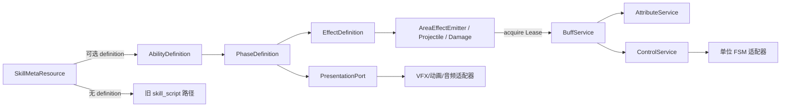

# 声明式战斗效果架构

状态：设计交付，尚未实现新运行时。当前狐狸技能仍维护自己的阶段和范围集合；BuffSystem 中的狐狸范围减速（`acquire_area_slow`）仍是专属实现；`Buff.gd` 仍以 get/set 保存旧值并整体恢复；眩晕仍直接切换 Enemy/Turret 状态；Lab 的参数调整仍未接通实际游戏。本文不代表这些迁移已经完成。

- [系统契约](combat_pipeline.md)：数据模型、类骨架、模块边界、执行与生命周期。
- [声明示例](combat_examples.md)：狐狸龙卷风、眩晕、普攻投射物和复用场景。
- [实施与验收](combat_rollout.md)：按依赖排列的工作包、性能预算和测试矩阵。

## 总览

## 术语

| 术语 | 含义 |
| --- | --- |
| Definition | 共享、只读的 Resource，不含运行数据 |
| Runtime | 每次执行分配的 RefCounted 实例，持有计时、集合与句柄 |
| BuffService | 生命周期与叠加门面：管理租约、持续/周期调度，并委托 AttributeService、ControlService 与 PresentationPort |
| Lease | `acquire` 返回的来源租约；`release` 幂等，代表"一个来源对一个目标的一份影响" |
| Scope | 句柄容器，退出时反向释放其持有的全部 Lease/句柄 |
| Generation | 单调递增代次号；句柄、阶段、对象池实例都携带，用于丢弃过期回调 |
| Gate | 带最大等待时间的条件门，事件可锁存、只消费一次 |
| Cue | 语义表现请求（如 `tornado.forming`），由适配器解释为 VFX/动画/音频 |

## 不在范围内

网络同步、存档/回放、技能树与天赋、AI 决策、可视化图编辑器的实现（仅保证数据兼容）。

本轮只提交设计文档。下一阶段先实现 Buff/属性/控制底座（见实施文档工作包 1），再实现阶段执行器，不开发可视化界面。后续 Inspector、agent 和图编辑器必须读写同一套强类型 Resource，调用同一校验器；运行时不依赖编辑器节点。
