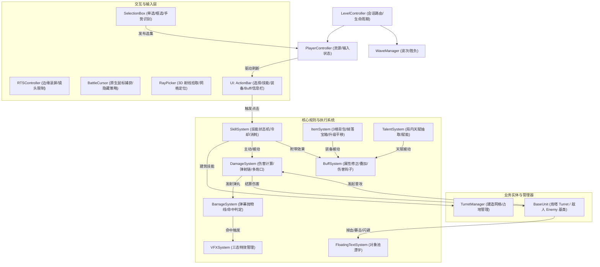
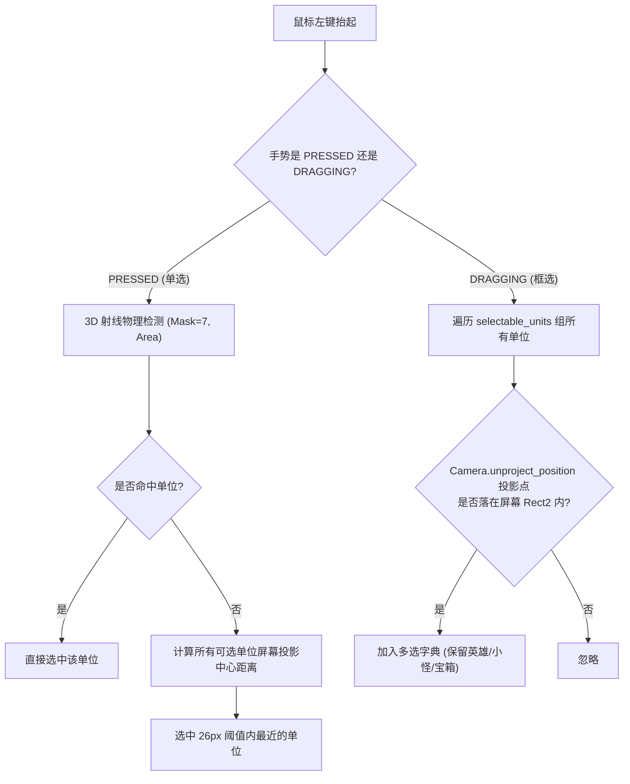

# TD-Demo 核心系统功能模块实现逻辑与落地架构

本文档针对本工程（Godot 4.x RTS 塔防 Demo）的技能、Buff、特效、动画、建造网格、鼠标选取、UI 交互、装备、天赋、战斗逻辑与弹道全流程进行深度梳理与落地固化。

---

## 目录

1. [全局架构与模块依赖全景](#1-全局架构与模块依赖全景)
2. [技能系统（Skill System）](#2-技能系统skill-system)
3. [BUFF 系统（Buff System）](#3-buff-系统buff-system)
4. [特效系统（VFX System）](#4-特效系统vfx-system)
5. [动画系统与双驱动协同（Animation System）](#5-动画系统与双驱动协同animation-system)
6. [建造网格与占地管理（Building Grid & Footprint）](#6-建造网格与占地管理building-grid--footprint)
7. [鼠标交互与单选/框选系统（Mouse Selection & RTS Control）](#7-鼠标交互与单选框选系统mouse-selection--rts-control)
8. [UI 界面与反馈架构（UI & Visual Feedback）](#8-ui-界面与反馈架构ui--visual-feedback)
9. [装备系统（Item & Equipment System）](#9-装备系统item--equipment-system)
10. [天赋系统（Talent System）](#10-天赋系统talent-system)
11. [战斗闭环逻辑与“弹道-动画-特效”全流程](#11-战斗闭环逻辑与弹道-动画-特效全流程)
12. [模块间关系与数据交互矩阵](#12-模块间关系与数据交互矩阵)

---

## 1. 全局架构与模块依赖全景

项目采用 **数据驱动（Resource 配置）+ 服务定位（SystemUtil/SOS）+ 事件解耦（SignalBus）+ 上下文快照（Context Snapshot）** 的混合架构。

---

## 2. 技能系统（Skill System）

* **主要代码**：
  * 系统管理器：[`System/skill_system/SkillSystem.gd`](../System/skill_system/SkillSystem.gd)
  * 技能实体域：[`System/skill_system/domain/Skill.gd`](../System/skill_system/domain/Skill.gd)
  * 技能上下文：[`System/skill_system/domain/SkillContext.gd`](../System/skill_system/domain/SkillContext.gd)
  * 元数据资源：[`System/skill_system/domain/SkillMetaResource.gd`](../System/skill_system/domain/SkillMetaResource.gd)
  * 技能弹丸域：[`System/skill_system/domain/SkillProjectile.gd`](../System/skill_system/domain/SkillProjectile.gd)

### 2.1 核心分类与标志位
* **释放类型 (`release_type`)**：
  * `TARGETED`（目标定向）：需选择具体单位或地面坐标。
  * `SELF_CAST`（自身释放）：以施法者自身为目标。
  * `NO_TARGET`（瞬发无目标）：无需指定目标直接生效。
  * `DIRECTION`（方向判定）：以鼠标朝向发射。
  * `CIRCLE_RANGE`（圆形范围选点）：以圆形 AOE 范围指示器选点释放。
  * `PASSIVE`（被动触发）：不占用主动施法，由事件自动派发。
* **生效类型 (`effect_type`)**：`DAMAGE`（伤害）、`HEAL`（治疗）、`BUILDING`（建造/升级建筑）、`BUFF`、`DEBUFF`。
* **目标类型 (`target_type`)**：`FLOOR`（地面）、`UNIT`（单位实体）、`SELF`、`FRIEND`（友方）、`ENEMY`（敌方）。

### 2.2 状态机（FSM）与生命周期
每个技能内部维护独立的状态机：
$$\text{Idle} \xrightarrow{\text{点击槽位}} \text{Indicate (Targeted/Building/Circle)} \xrightarrow{\text{二次点击确定}} \text{Release} \xrightarrow{\text{进入前摇}} \text{Casting} \xrightarrow{\text{计时器}} \text{Cool\_Down} \xrightarrow{\text{超时}} \text{Idle}$$

* **指示器阶段（Indicate）**：
  1. 调用 `BattleInput.request_cursor_hidden(self, true)` 隐藏系统光标；
  2. 唤起 3D 范围指示圈（`PlayerSkillScopeIndicator`）或建造虚影；
  3. 通过 `PlayerController.limit_move(center, radius)` 将鼠标有效活动范围限制在施法距离内；
  4. 支持按 **Esc** 键或右键随时取消，状态回退至 `Idle`。
* **费用校验与原子提交**：
  在进入 `Release` 状态瞬间，由 `PlayerController.commit_skill_cost(skill_context)` 一次性提交扣除魔法、金币、木材；校验未通过则终止释放并发送提示信息（`MessageBar`）。
* **上下文独立快照 (`SkillContext.snapshot()`)**：
  每次施法生成一份上下文深拷贝，保存当前的 `skill`、`source`、`target`、`target_position`、`building`、`release_id`，防止异步协程运行期间被下一次施法覆盖。
* **会话安全性校验 (`_session_valid`)**：
  在异步 `await` 或前摇后摇执行后，校验 `LevelController.session_id` 是否发生改变，确保重开、关卡切换时废弃旧操作。

### 2.3 自动施法与被动机制
* **自动施法（Auto Release）**：开启后，单位动态添加 `Area3D`（`_area_ai`，半径为 `release_distance`）。通过监听 `area_entered` 与 `skill_cool_down` 信号，在敌人进入且技能就绪时自动触发释放。
* **被动技能（Passive）**：在宿主 `_ready` 时监听宿主的 `attack_unit` 信号。借助 `ProbabilityController` 独立伪随机计数器，当普攻触发概率满足时自动转入 `Release` 状态执行技能脚本。

---

## 3. BUFF 系统（Buff System）

* **主要代码**：
  * 系统管理器：[`System/buff_system/BuffSystem.gd`](../System/buff_system/BuffSystem.gd)
  * Buff 实体域：[`System/buff_system/domain/Buff.gd`](../System/buff_system/domain/Buff.gd)
  * Buff 资源基类：[`System/buff_system/domain/buff_resource.gd`](../System/buff_system/domain/buff_resource.gd)

### 3.1 跨模块赋能链
Buff 可由技能（`SkillMetaResource`）、装备（`ItemResource`）、天赋（`TalentResource`）派生。统一通过 `BuffSystem.init_buff_for_unit_by_res(source, ref, ele)` 实例化，将 Buff 挂载到单位的 `buff_map` 中。

### 3.2 属性修正与高精度回滚机制
Buff 对单位属性（如 `attack_value`、`move_speed`、`armor_amount`）的修改采用**增量记录法**：
* 属性修改类型：固定值（`VALUE`）与百分比（`PERCENT`）。
* 应用时记录 `prop_value_delta`：
  $$\Delta = \text{ref\_val} \times \frac{\text{value}}{100} \times \text{value\_dir} \quad (\text{百分比}) \qquad \text{或} \qquad \Delta = \text{value} \times \text{value\_dir} \quad (\text{固定值})$$
* 移除时执行 `ref_val -= prop_value_delta`，彻底消除浮点数除法反复叠加产生的数值漂移。
* 在技能或单位升级刷新属性时，`refresh()` 方法先回退旧 `prop_value_delta`，基于最新基准属性计算新增量，避免属性数值膨胀。

### 3.3 叠加、排斥与伤害管道钩子
* **计数与叠加限制**：通过全局字典 `__buff_inst_counter["code&instance_id"]` 统计每个单位身上的特定 Buff 实例数。若超过 `max_overlay_num` 则拒绝添加或触发 `buff_cooldown_extend`（重置并延长存活时间）。
* **排除规则 (`exclude_level`)**：
  * `ALL`：允许与任何 Buff 共存；
  * `TYPE`：同类型 Buff 排斥；
  * `SELF`：同 code Buff 排斥（仅能存在 1 个）；
  * `NONE`：身上存在任何 Buff 则无法附加上去。
* **伤害管道钩子注入**：
  * **攻击侧修饰器**（如暴击 `critical_hit_buff.gd`）：通过 `unit.unit_action_damage_regist` 注入 Callable，动态修改 `DamageCtx.damage_type` 与伤害乘数。
  * **受击侧修饰器**（如闪避 `miss_buff.gd`、减伤 `defence.gd`）：通过 `unit.unit_take_damage_regist` 注入 Callable。
  * **状态控制**（如眩晕 `stun_buff.gd`）：进入时强制将目标状态切换为 `EnemyState.STUN`，停止 `_process` 寻路，播放待机动画；离开时根据生命状态平稳恢复为 `WALKING` 或 `DEAD`。

---

## 4. 特效系统（VFX System）

* **主要代码**：
  * 特效管理器：[`System/vfx_system/VFXSystem.gd`](../System/vfx_system/VFXSystem.gd)
  * 特效资源：[`System/vfx_system/vfx.gd`](../System/vfx_system/vfx.gd)

### 4.1 约定式命名与三态生命周期
特效资源统一存放在 `res://VFX/`，系统在初始化时自动递归加载至 `vfx_res_map`。采用三态后缀命名约定：`vfx_<name>_<type>.tscn`：
1. **`BURNING`（持续态 / 光环）**：
   * 适用场景：护盾、升级光柱、减速光环、持续灼烧。
   * 挂载方式：常驻挂载于目标单位或局部骨骼，随宿主位置同步移动。
2. **`RUNNING`（运动态 / 弹道）**：
   * 适用场景：飞行火球、回旋战锤、行进龙卷风。
   * 挂载方式：挂载至飞行弹道容器或 `BarrageSystem` 中，沿轨迹物理或插值运动。
3. **`DESTORY`（撞击态 / 销毁爆炸）**：
   * 适用场景：火球落点爆炸、战锤撞击碎石、冰冻碎裂。
   * 挂载方式：弹丸命中后在目标世界坐标或挂点高度（`target._height * 0.5`）处生成，播放完毕自动延时 `queue_free()`。

### 4.2 特殊受击反馈表现
* **白模闪烁 (`mesh_standing`)**：单位初始化时自动克隆自身的首个 `MeshInstance3D`，应用专用材质 [`hit_flash.tres`](../Asserts/materials/hit_flash.tres) 并绑定原骨骼；受伤时显隐 0.1 秒，避免打断模型本身的材质过渡。
* **地面血迹贴图 (`Decal`)**：敌人逻辑死亡时在世界坐标生成贴花，按单位包围盒（AABB）缩放，不占用物理碰撞。

---

## 5. 动画系统与双驱动协同（Animation System）

* **主要代码**：
  * 单位基类：[`Scripts/base/BaseUnit.gd`](../Scripts/base/BaseUnit.gd)
  * 单位资源基类：[`Scripts/base/BaseUnitResource.gd`](../Scripts/base/BaseUnitResource.gd)
  * 资产绑定审计：[`Scripts/utils/AssetBindingAudit.gd`](../Scripts/utils/AssetBindingAudit.gd)

### 5.1 双驱动协同保护机制（AnimationPlayer + AnimationTree）
为解决高级骨骼动画机（`AnimationTree`）与瞬态动作播放（`AnimationPlayer`）互相冲突的问题：
1. 常态由 `AnimationTree` 驱动移动、待机混合。
2. 触发瞬态动作（攻击 `anim_attack`、受击、施法 `anim_release`、死亡 `anim_death`）调用 `play_action_animation(animation)`：
   * 自增 `action_animation_generation`，防止并发覆盖；
   * 临时关闭 `AnimationTree.active = false`；
   * 交由 `AnimationPlayer` 独占播放；
   * 连接 `AnimationPlayer.animation_finished`；动作结束后若单位存活，自动恢复 `AnimationTree.active = true`。

### 5.2 攻击动作与伤害判定点对齐
* **固定秒数对齐**：使用 `anim_ack_point`（如 0.03 秒）进行简单延迟。
* **归一化时间对齐**：使用 `anim_ack_normalized`（取值 0.0 ~ 1.0）。在 `DamageSystem.attack_delay` 中动态按动画片段时长与当前播放倍速精确计算发射帧：
  $$\text{Delay} = \frac{\text{Length} \times \text{anim\_ack\_normalized}}{\max(\text{speed\_scale}, 0.001)}$$

### 5.3 动画播放速率独立性
移动速度仅联动行走动画的 `speed_scale`（公式：$\text{move\_speed} \times \text{anim\_speed\_factor} / 5$），与攻击动作、施法动作以及死亡动作的播放速率完全隔离，避免攻击手感变形。

---

## 6. 建造网格与占地管理（Building Grid & Footprint）

* **主要代码**：
  * 防御塔建造管理：[`Unit/turret/TurretManager.gd`](../Unit/turret/TurretManager.gd)
  * 射线拾取相机：[`RayPickerCamera/ray_picker_camera.gd`](../RayPickerCamera/ray_picker_camera.gd)
  * 建造动作技能：[`System/skill_system/resources/building/building_base_turret.gd`](../System/skill_system/resources/building/building_base_turret.gd)

### 6.1 坐标系变换与多格占地（Footprint）
* **坐标转换**：
  $$\text{Cell} = \text{Grid.local\_to\_map}(\text{Grid.to\_local}(\text{WorldPos}))$$
  $$\text{WorldPos} = \text{Grid.to\_global}(\text{Grid.map\_to\_local}(\text{Cell}))$$
* **多格占地 (`building_footprint: Vector2i`)**：支持 $1 \times 1$ 至 $8 \times 8$ 占地。`footprint_cells(cell, definition)` 循环生成占用的所有格子数组。
* **放置中心定位**：
  $$\text{PlacementPosition} = \frac{\text{cell\_to\_world}(\text{cells}[0]) + \text{cell\_to\_world}(\text{cells}[-1])}{2}$$

### 6.2 独立运行占用表与建造验证
* **运行占用与地图解耦**：场景美术配置的 `GridMap` 仅作为静态可建性判断（`get_cell_item(cell) == 0` 为可建）。动态运行占用完全维护在独立的 `occupied: Dictionary[Vector3i, instance_id]` 中。
* **实时预览**：每帧通过相机射线更新预览塔与绿色高亮边框网格（`cell_mesh_indicator`）。
* **原子建造事务**：
  1. 校验地块未被占用且费用充足；
  2. 预先向 `occupied` 登记所有格子，并写入单位元数据（`build_cells`）；
  3. 挂接 `tree_exiting` 和 `logical_death` 信号自动释放格子占用；
  4. 播放建筑天降落位缓动动画（Tween ExpoOut 从高空 30 米下落）与落地音效。
* **升级无缝转交**：在建筑升级（如 Turret 换高阶模型）时，调用 `replace_building(old, replacement)` 将原占用的格子属权直接换签到新单位实例，中途不释放格子，杜绝同一帧内被其它建造穿透抢占。

---

## 7. 鼠标交互与单选/框选系统（Mouse Selection & RTS Control）

* **主要代码**：
  * 框选手势控制：[`Components/selection_box/SelectionBox.gd`](../Components/selection_box/SelectionBox.gd)
  * 原生鼠标限制管理：[`Scripts/controller/BattleCursor.gd`](../Scripts/controller/BattleCursor.gd)
  * 战场输入屏障：[`Scripts/utils/BattleInput.gd`](../Scripts/utils/BattleInput.gd)
  * RTS 镜头控制：[`Scripts/controller/RTSController.gd`](../Scripts/controller/RTSController.gd)
  * 玩家状态管理：[`Player/player_controller.gd`](../Player/player_controller.gd)

### 7.1 手势状态机与拖动阈值
* 手势状态分为：`IDLE` $\rightarrow$ `PRESSED` $\rightarrow$ `DRAGGING`。
* **拖动死区**：鼠标按下后移动距离达到 **6 像素** 锁定为 `DRAGGING` 并开启屏幕矩形指示器（`RectangularSelection2D`），防止手抖单选误变成微小框选。

### 7.2 双路径选取算法

### 7.3 交互屏障与边界鲁棒性
* **UI 穿透阻挡**：真正的 UI 控制底栏统一加入 `blocks_world_input` 组。`BattleInput.pointer_available` 实时比对全局控件矩形。在 UI 上抬键会安全触发 `cancel_selection("release_over_ui")`，避免误点战场穿透。
* **原生鼠标限制与滚屏**：战斗默认采用 `DisplayServer.MOUSE_MODE_CONFINED`（F2 临时解锁）。即使鼠标推到屏幕最外沿触发 `mouse_exited`，`RTSController` 仍以视口采样维持边缘滚屏。窗口失焦、Pause 暂停、打开设置面板时，框选与滚屏立即主动清理。
* **右键指令下发**：单选或框选防御塔后，右键点击视野内敌人直接指定集火目标；右键点击地面掉落的宝箱（`TreasureChest`）触发拾取动作。

---

## 8. UI 界面与反馈架构（UI & Visual Feedback）

* **主要代码**：
  * 命令操作栏：[`Components/action_bar/action_bar.gd`](../Components/action_bar/action_bar.gd)
  * 集中血条绘制：[`Components/health_bar/screen_health_bars.gd`](../Components/health_bar/screen_health_bars.gd)
  * 飘字对象池：[`Components/floating_text/FloatingTextSystem.gd`](../Components/floating_text/FloatingTextSystem.gd)
  * 主战斗 UI：[`UI/UI.gd`](../UI/UI.gd)

### 8.1 ActionBar 五大容器架构
底栏基于事件驱动，监听 `player_selected_units` 信号切换展示内容：
1. **SelectionBarComponent**：展示当前选中的所有单位头像，点击可快速切换主受控单位。
2. **SkillBarComponent**：装配主单位技能。自动映射快捷键（Q/W/E/R/T）；监听魔法/金币/木材变动信号，动态通过 Shader 置灰禁用；挂接 `cool_down_timer` 实时驱动扇形冷却进度条。
3. **ItemBarComponent**：展示 3 格装备栏，支持空槽位（`item_slot_empty`）与满槽位切换。
4. **PlayerBarComponent**：显示玩家金币、木材、基地当前血量及选中单位名称头像。
5. **BuffBarComponent**：动态挂载宿主单位的 Buff 图标，监听 `buff_enter` / `buff_exit` 增删，支持悬浮说明与持续时间倒计时。

### 8.2 性能优化：集中绘制与对象池
* **集中血条渲染 (`ScreenHealthBars`)**：场上大量敌人不再各自挂载高开销的 3D Billboard 视口控件，而是统一由一个全屏 2D CanvasLayer 在 `_draw()` 中集中绘制受损或被选中的敌人血条，弱引用（WeakRef）持有单位，不造成单位释放内存泄漏。
* **漂浮文字对象池 (`FloatingTextSystem`)**：伤害与状态文字（伤害数值、`miss`、技能名称）使用容量为 10~64 的预分配对象池。文字播完自动重置参数并回收，杜绝每秒大量伤害产生节点频繁分配导致的 GC 卡顿。

---

## 9. 装备系统（Item & Equipment System）

* **主要代码**：
  * 装备系统管理：[`System/item_system/ItemSystem.gd`](../System/item_system/ItemSystem.gd)
  * 装备实体域：[`System/item_system/domain/Item.gd`](../System/item_system/domain/Item.gd)
  * 装备资源配置：[`System/item_system/domain/item_resource.gd`](../System/item_system/domain/item_resource.gd)
  * 地面宝箱实体：[`System/item_system/resources/treasure_chest.gd`](../System/item_system/resources/treasure_chest.gd)

### 9.1 规则约束与掉落
* **容量限制**：每个单位固定拥有 **3 格背包**。
* **唯一性校验**：单位禁止装备两件同名道具（通过 `source.item_map.has(code)` 拦截并弹窗提示）。
* **爆装与掉落**：敌人配置 `drop_item_metas`。逻辑死亡时由 `ItemSystem.drop_item` 独立判定概率，在地面生成具备 3D 碰撞的宝箱实体 `treasure_chest.tscn`。

### 9.2 拾取与赋能
* 选中防御塔右键点击宝箱，触发 `ItemSystem.pick_up`。
* 实例化道具节点并作为子节点挂载到单位，同时调用 `BuffSystem.init_buff_for_unit_by_res` 为宿主赋予道具被动 Buff。
* 刷新底栏装备槽并销毁地面宝箱。

### 9.3 建筑升级时的装备无损迁移（Transfer）
防御塔升级换模型时，由 `ItemSystem.transfer_all(source, destination)` 处理：
1. 预先注销原单位身上由该装备产生的所有 Buff 和回调；
2. 清理悬空的游离节点，将 `Item` 节点直接 `reparent` 到新建筑；
3. 将装备配置与同类唯一性规则在新建筑上重新注册；
4. 重新为新建筑挂载道具 Buff，并延迟刷新当前选中的背包 UI。

---

## 10. 天赋系统（Talent System）

* **主要代码**：
  * 天赋系统管理：[`System/talent_system/TalentSystem.gd`](../System/talent_system/TalentSystem.gd)
  * 天赋实体域：[`System/talent_system/talent.gd`](../System/talent_system/talent.gd)
  * 天赋卡牌槽位：[`System/talent_system/talent_ui/choose_talent_bar.gd`](../System/talent_system/talent_ui/choose_talent_bar.gd)

### 10.1 设计与运作
* **全局主控绑定**：天赋系统服务于玩家主角实体（`gdbot`）。
* **局内选择弹窗**：触发选择事件时唤起全屏模态选择面板 `talent_choose_layout.tscn`。卡牌具备鼠标滑过高亮着色器动画（`burning`）。
* **天赋生效**：玩家点击卡牌（如贪婪 `greedy_talent`、极速冷却 `cooldown_talent`、终极封锁 `shutdown_talent`），由 `PlayerController.add_talent` 实例化，并通过 `BuffSystem` 赋予玩家全局属性增益或被动回调。

---

## 11. 战斗闭环逻辑与“弹道-动画-特效”全流程

### 11.1 完整战斗时序交互流程图

```mermaid
sequenceDiagram
    autonumber
    participant T as 塔 (Turret)
    participant AP as AnimationPlayer / Tree
    participant DS as DamageSystem
    participant BS as BarrageSystem
    participant P as Projectile (弹丸)
    participant E as 目标敌人 (Enemy)
    participant VFX as 特效与飘字 (VFX & Text)

    Note over T: 寻敌范围检测，筛选最近敌人
    T ->> T: Slerp 平滑旋转炮台面向敌人 (瞄准 97%)
    T ->> AP: play_action_animation("anim_attack")
    T ->> DS: action(source, target)
    DS ->> DS: 等待攻击帧回复点 (attack_delay)
    
    rect rgb(30, 40, 60)
        Note over DS, BS: 多火力点并发 (并发处理，无阻塞)
        DS ->> AP: 播放炮口开火动画
        DS ->> BS: action(fire_pos, target, fire_projectile)
        BS ->> P: 实例化弹丸并挂载 RUNNING 特效
    end

    loop 每物理帧追尾与弧度插值
        P ->> P: 直线 Lerp 插值 + Vector3.UP * 抛物线高
        P ->> P: safe_look_at 朝向实时更新
    end

    P ->> DS: 抵达目标 (finished / resolved 信号)
    P -->> P: queue_free()
    
    rect rgb(40, 60, 40)
        Note over DS, E: 伤害管线与受击反馈
        DS ->> E: take_damage(DamageCtx)
        E ->> E: 执行受击前置修饰器 (闪避/减伤/暴击)
        E ->> E: 扣除 health，触发 unit_take_damage
        E ->> VFX: 受击白模闪烁 (mesh_standing 0.1s)
        DS ->> VFX: 目标身上生成 DESTORY 特效 (锤子落点/爆炸)
        DS ->> VFX: 弹出飘字 FloatingText (伤害值/暴击/Miss)
    end

    opt 如果配置弹射次数 (bounce_times > 0)
        DS ->> DS: 搜索 bounce_distance 范围内下一个活体敌人
        DS ->> BS: 以当前受击点为起点，发射 bounce 弹丸
    end

    opt 如果生命值 <= 0
        E ->> E: do_logical_death("killed")
        E ->> AP: 播放 anim_death 死亡动画
        E ->> VFX: 地面生成血迹 Decal 贴花
        E ->> E: 触发金币/木材增加、掉落宝箱检测、通知波次计数
    end
```

### 11.2 核心机制细节
1. **二次贝塞尔等价抛物线弹道**：
   在 `projectile.gd` 中，弹丸轨迹遵循：
   $$\vec{P}_{\text{curr}} = \text{lerp}(\vec{P}_{\text{start}}, \vec{P}_{\text{target}}, t) + \vec{UP} \cdot (\text{arc\_factor} \cdot t \cdot (1 - t))$$
   在飞行动画中自动跟踪目标当前的实时位置偏移；目标若中途死亡，弹丸在超时或落点处自动释放。
2. **多炮口轮射（Multi-Muzzle Firing）**：
   炮塔资源允许配置多个 `Marker3D` 并划分为不同组（如“甲”、“乙”）。系统通过并发调度器（`process_all_fire_positions_concurrent`）发射弹幕，并自增轮换火力点键，实现多管齐射或交替连续开火。
3. **弹射链机制（Bounce Chain）**：
   主目标命中后，若宿主 `bounce_times > 0`，调用 `get_units_in_range_physics_3d` 搜索范围内活体敌人，生成标记为 `&"bounce"` 的次级弹丸，附带衰减系数（`bounce_decay_factor`）。
4. **会话级资源防御 (`session_id`)**：
   所有异步协程（`await`）、技能前摇、弹幕返回，均比对 `LevelController.session_id`。一旦玩家中途重开或返回主菜单，旧会话的所有延迟回调自动放弃执行，杜绝跨局逻辑污染与孤立节点残留。

---

## 12. 模块间关系与数据交互矩阵

| 交互发起方 | 交互目标方 | 交互介质 / 机制 | 业务目的与生命周期保障 |
|---|---|---|---|
| **SelectionBox** | **PlayerController** | `selecting_finished` 信号 | 提交视口单选/框选结果字典，刷新已选单位集合与光标状态 |
| **PlayerController** | **UI (ActionBar)** | `SignalBus.player_selected_units` | 驱动底栏头像、技能槽、装备槽、Buff槽重新排布 |
| **ActionBar (Skill)**| **SkillSystem** | `Skill.change_state(Release)` | 点击槽位触发施法，完成费用校验、目标指示与技能脚本驱动 |
| **Skill (建筑技能)** | **TurretManager** | `SignalBus.building_floor_indicator_*` | 开启地面建造网格高亮与射线预览，落位完成锁定地块 |
| **Turret (攻击状态)**| **DamageSystem** | `DamageSystem.action(source, target)` | 对齐攻击动作帧，调度多炮口并发与弹道请求 |
| **DamageSystem** | **BarrageSystem** | `BarrageSystem.action(...)` | 挂载飞行特效，生成 `Projectile` 抛物线运动，等待命中信号 |
| **DamageSystem** | **BaseUnit** | `receive_damage(ctx)` | 执行攻击方与受击方 Buff 钩子，计算护甲闪避，扣减 HP |
| **ItemSystem** | **BuffSystem** | `init_buff_for_unit_by_res` | 装备拾取/升级平移时，同步向宿主挂载或注销装备被动 Buff |
| **TurretManager** | **ItemSystem** | `transfer_all(old, new)` | 防御塔升级时，将旧塔背包中的装备无损平移至新塔 |
| **BaseUnit (死亡)** | **WaveManager** | `logical_death` / `tree_exiting` | 扣减波次活体敌人计数，全部清场时触发波次通关与结算 |
| **WaveManager** | **LevelController** | `finish_battle(is_win)` | 胜负判定，快照结算数据（金币/杀敌数/波次），唤起结算界面 |
