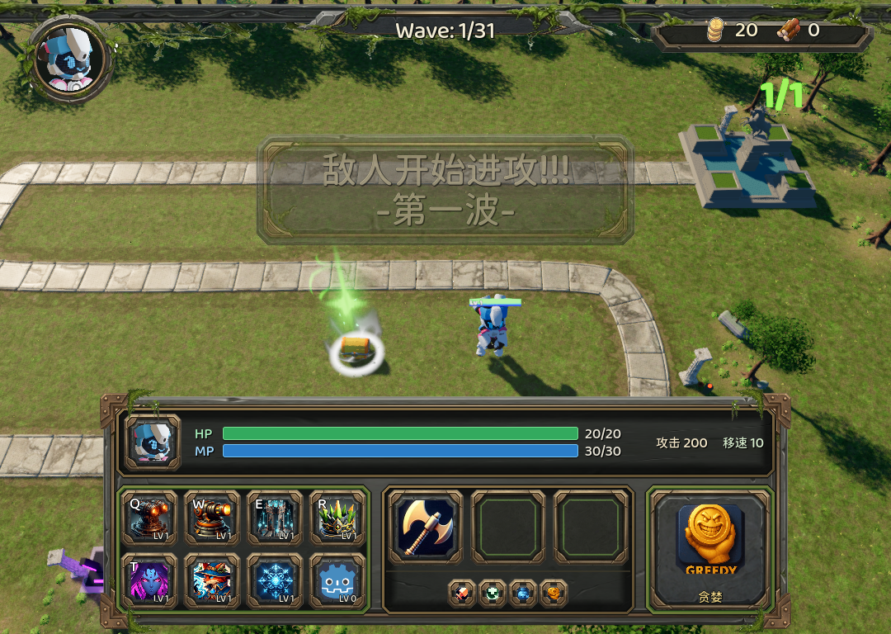
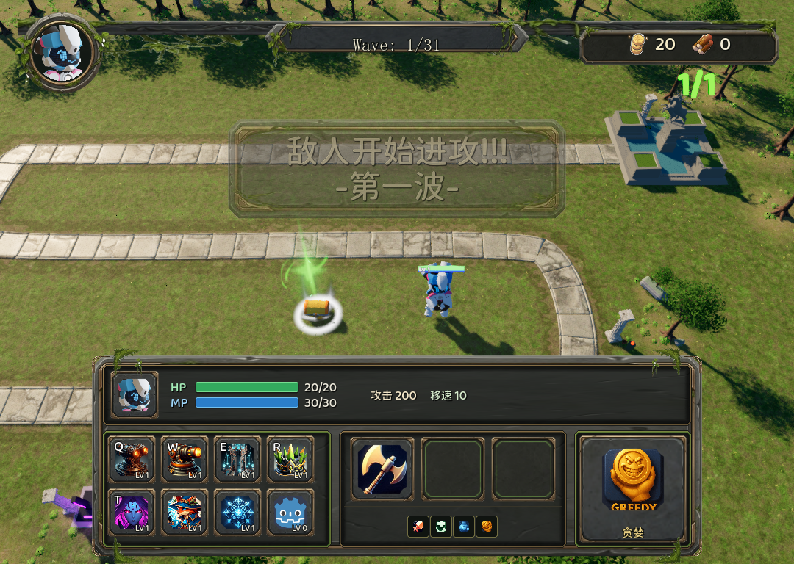
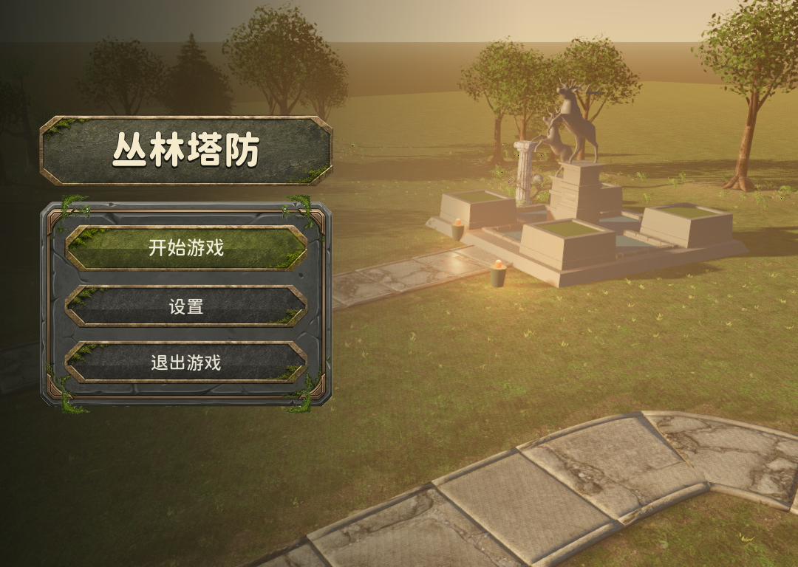
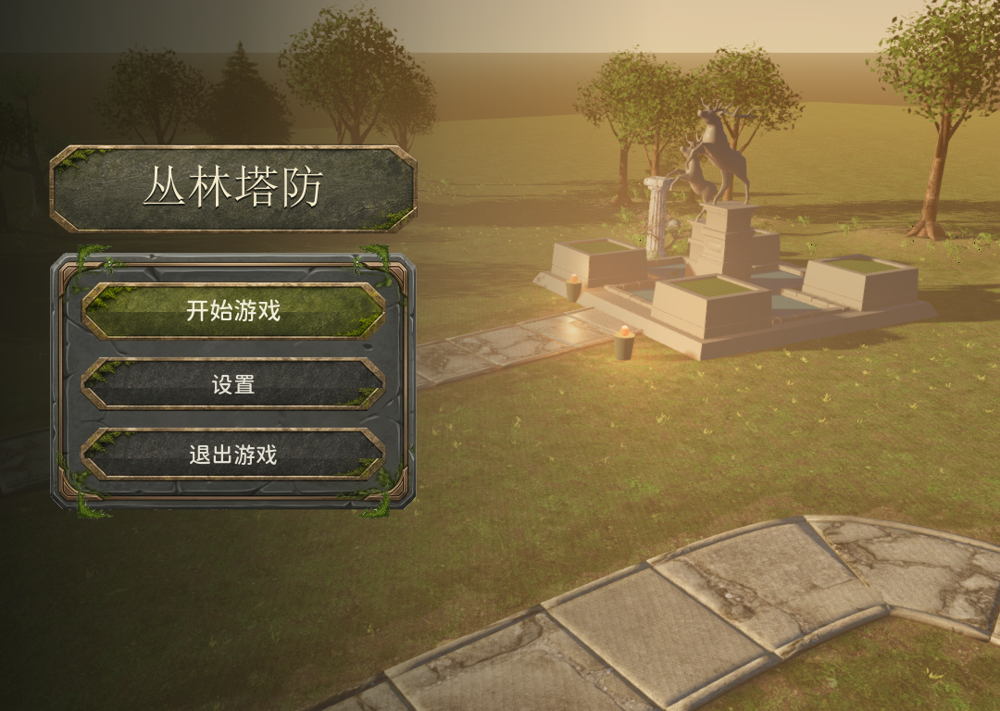

# A「苔石精修」逐元素细节复核

基准：[用户指定 A 概念稿](../material_alignment/reference_a.png)。本轮以当前工作区的最新实机为修改起点；与上一轮文档中的旧截图有所不同。保留现有数据与操作流程，重点修正装饰的比例和层级。

## 修改前后

| 页面 | 本轮修改前 | 本轮修改后 |
|---|---|---|
| 战斗单选 |  |  |
| 主菜单 |  |  |

## 逐项检查结果

| 元素 | 对照发现 | 本轮处理 |
|---|---|---|
| 顶栏整体 | 上沿过紧，藤蔓密集，部分轮廓贴边 | 框体下移至安全区；藤蔓由原生平铺改为受控区域缩放，留出两侧间距 |
| 波次铭牌 | 两侧切角厚重，字体偏现代圆体 | 调整贴图导入尺度与九宫格边缘；使用共用衬线展示字体 |
| 金币／木材铭牌 | 端部包边比例过重 | 同步缩小纹理与边缘像素，保留原有图标和实时资源值 |
| 头像环 | 当前已具备石材、铜圈与自然叶片 | 本轮检查后保留，不重新绘制角色或增加挂件 |
| 底栏外框 | 框线厚度接近内部模块，层级不清 | 框体纹理及九宫格边缘按同一倍率调整，减少粗重包边 |
| 铜角装饰 | 44px 铆钉角板偏机械风 | 替换为约26px的细双铜线转角，去掉显眼铆钉；四角原生镜像复用 |
| 苔藓角饰 | 已使用独立植物图，位置可避开内容 | 保留四角装饰；仍为鼠标穿透，未继续加密或堆叠新植物 |
| 内凹模块 | 深槽宽边与外框争抢注意力 | 导入尺度及九宫格边缘同步减半，使其退为次级容器 |
| 技能槽 | 14px 边缘在60px级图标上过重 | 纹理按显示尺度导入，边缘改为7px，内容边距5→3；保留冷却、等级和快捷键 |
| 装备槽 | 空槽与已装备槽的厚度不统一 | 空槽按相同倍率收敛，保留三槽、物品拖动及原有空槽行为 |
| Buff 区 | 小图标套用复杂技能边框，图标被挤压 | 独立1px细铜色边框；初始化类型确定后重新应用相应样式，防止通用边框覆盖 |
| 玩家天赋卡 | 图标、天赋名称及区域已经独立 | 保留现有功能与文字，随共用材质变薄，不扩展三选一卡到战斗底栏 |
| 单位摘要 | HP／MP几乎占满横条，显著强于技能区 | 改为稳定的短条宽度，保留数值、攻击与移速展示，减少无意义拉伸 |
| 菜单标题 | 圆体及厚阴影与A稿的雕刻感不同 | 改为系统衬线候选，去大描边、减轻阴影，保留已有标题铭牌 |

上述为视觉比例与材质处理记录，不代表与生成概念稿逐像素一致。角色插画和场景灯光没有纳入本轮重绘；系统字体的最终字形随平台可用字体而变化。

## 实机页面

- [1080 设置](1080x768_settings.png)、[1080 Tooltip](1080x768_tooltip.png)
- [1920 战斗](1920x1080_battle.png)、[1920 设置](1920x1080_settings.png)
- [2560 战斗](2560x1080_battle.png)、[2560 Tooltip](2560x1080_tooltip.png)

## 验证

- 原生 Forward+ `tests/ui_material_review.gd`：1080×768、1920×1080、2560×1080，输出三个 `UI_MATERIAL_VIEW_OK` 与 `UI_MATERIAL_REVIEW_OK`；底栏及提示框边界检查通过。
- 原生 Forward+ `tests/game_flow_smoke.gd`：三轮通过，`FLOW_TEST_OK`，三轮生命周期采样均为 nodes=1021、orphans=0。
- 最终两个原生运行日志无 SCRIPT ERROR／ERROR；仍有既有 Fox_Mega.tres UID 回退警告。编辑器 Headless 导入日志的既有 Shader 与插件退出错误不计为原生游戏通过。
- 所有角饰仍使用 `mouse_filter=2`；没有修改技能规则、Buff效果或物品规则。截图随真实波次与资源变化，数值不是美术固定文本。

## 新增素材来源

细铜角通过内置 imagegen 生成，原始文件 `exec-a6361dc9-dbf2-498d-92b0-45a6181c23e5.png` 保留在会话 generated_images 中，项目副本为 `UI/theme/textures/bronze_fillet.png`。组件通过 AtlasTexture 取转角区域，再镜像用于四角；没有对原图做破坏性修改。

生成提示词：

> ONE isolated premium jungle ruin UI corner ornament on transparent background. Top-left L-shaped very thin aged bronze inlay, two slender parallel rails forming an elegant rounded chamfered 90 degree corner, small diagonal engraved seam, no rivets, no screw heads, no bolts, no symbols, no moss, no thick solid triangular plate. Muted pale copper champagne highlights and dark patina in crevices, realistic restrained metal, delicate proportions exactly like fine edging of classical stone game interface. Corner decoration only occupies top and left edges, middle empty transparent. Orthographic flat front view, no extra panels or writing, reusable asset to display at 24x24 pixels. Elegant weathered craftsmanship, NOT mechanical steampunk armor.
