# A 稿还原：逐元素对照

**最新：[第十轮统一比例与四角轮廓复核](round_10/README.md)。[第九轮](round_09/README.md) · [第八轮全页检查](round_08/README.md) · [第七轮](round_07/README.md) · [第六轮](round_06/README.md) · [第五轮](round_05/README.md) · [第四轮](round_04/README.md) · [第三轮](round_03/README.md) · [第二轮](round_02/README.md)。以下为首轮留档。**

本轮已实现薄边槽位、取消侵蚀图标的内层蒙版、默认单位条恢复、属性迁入单位悬停详情。以下为确定性裁切，非生成截图。

## 底栏左侧叶片

|参考4倍|修改前4倍|修改后4倍|
|---|---|---|
|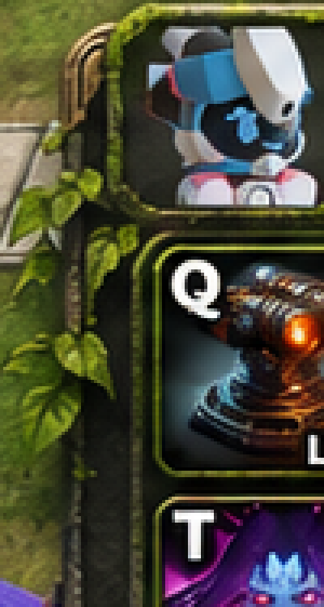|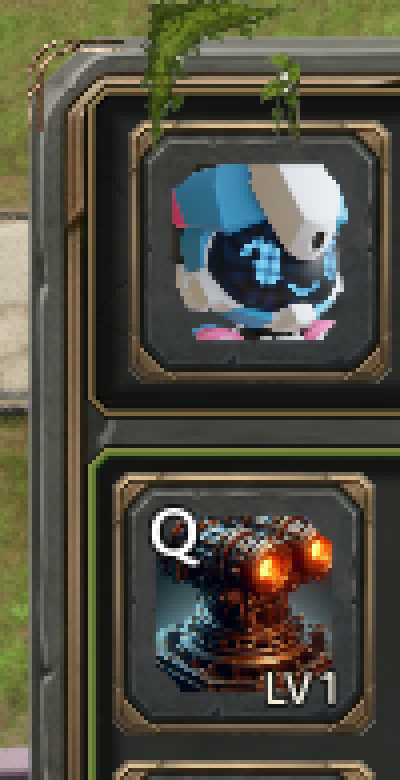|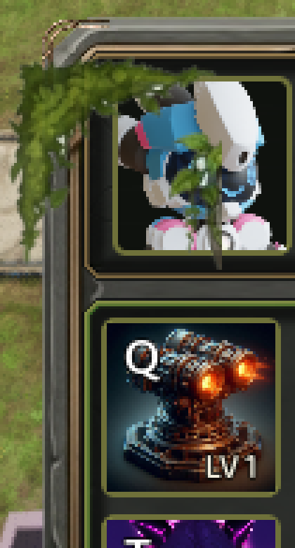|

## 技能槽

|参考4倍|修改前4倍|修改后4倍|
|---|---|---|
|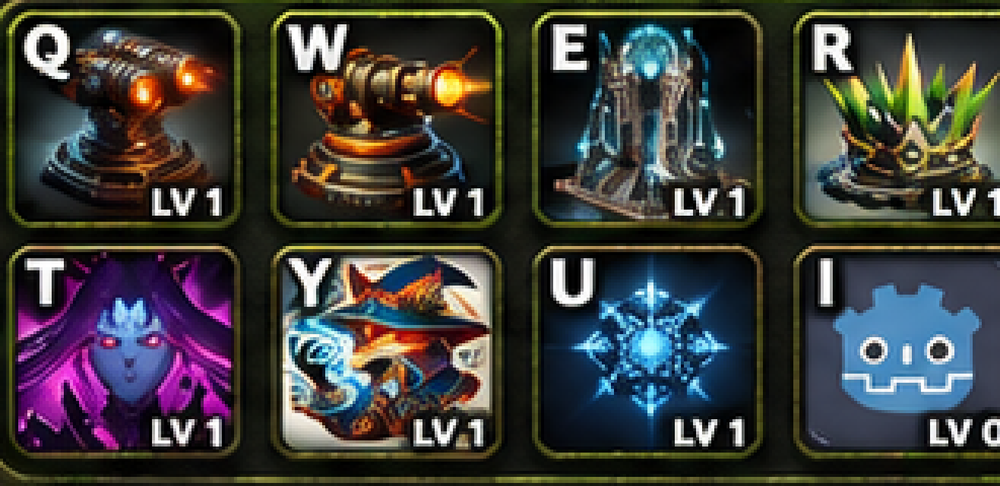|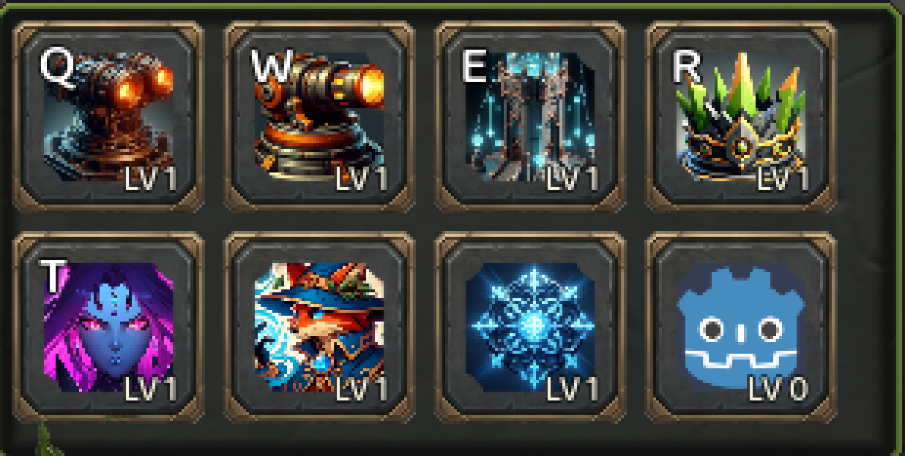|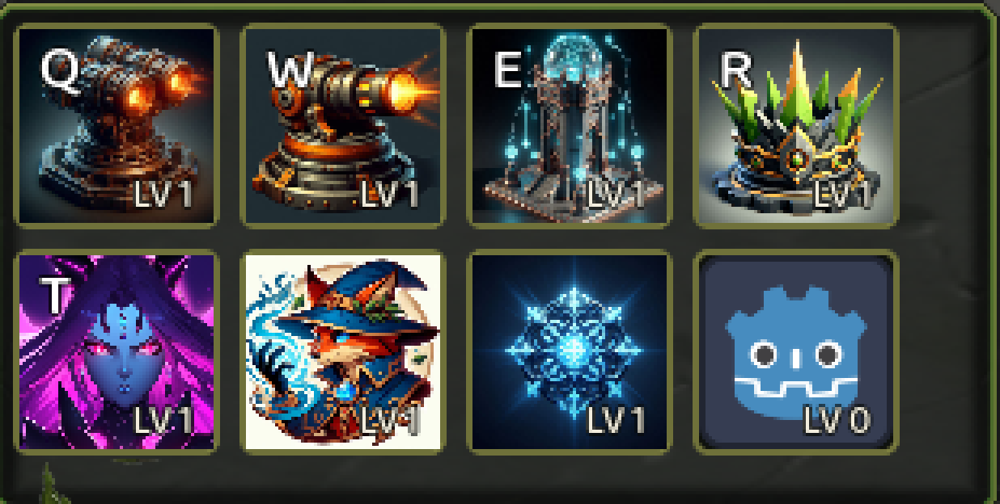|

## 装备与 Buff

|参考4倍|修改前4倍|修改后4倍|
|---|---|---|
|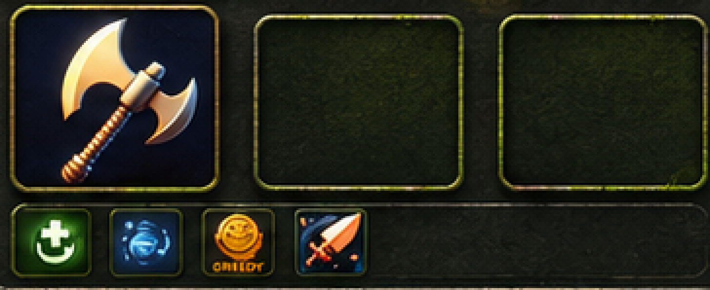|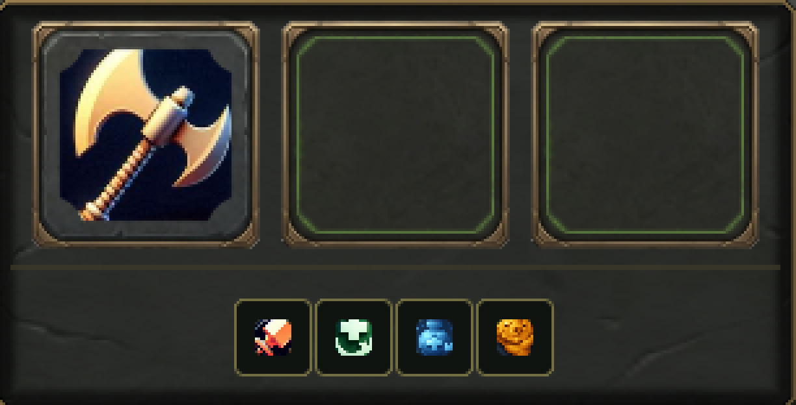|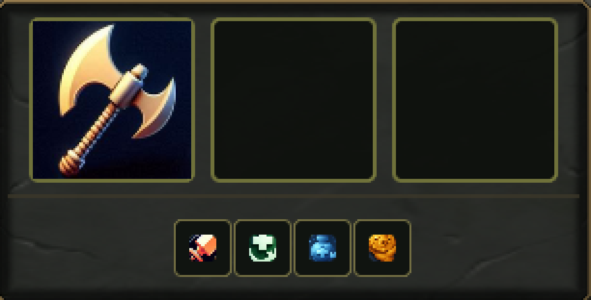|

## 顶部铭牌

|参考4倍|修改前4倍|修改后4倍|
|---|---|---|
|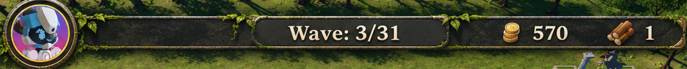|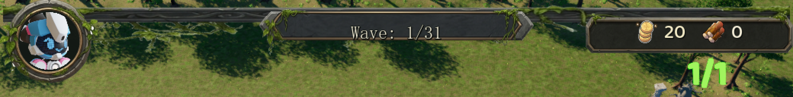||

## 首轮验收状态（留档）

三分辨率原生视觉检查通过。尚未达到95%视觉还原目标：叶片仍使用既有小叶簇放置，尚缺参考的独立细藤与自然下垂叶型；槽位几何已简化，但石面和铜线需继续逐项匹配。当前对照裁片为元素级取样，未完成全部裁片的同尺度轮廓配准，不能据此输出相似度分数。不得将本轮阶段结果标记为计划全部完成。
