# 第二轮：叶型、薄框与同尺度对齐

本轮直接修改游戏资源，以下均为真实截图和确定性裁切。三列从左到右依次为参考、首轮修改前、当前实机。未用生成模型重绘或修饰截图。

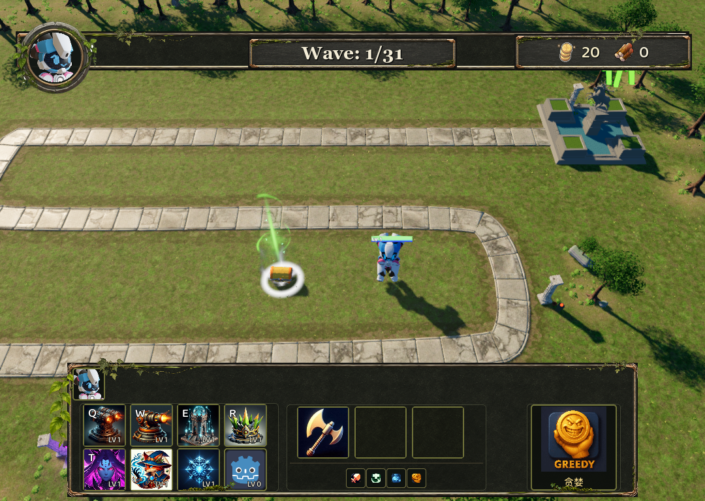

## 实测结果

| 项目 | 当前值 | 依据 |
|---|---|---|
| 底栏节点 | 874×212px | 原生 get_global_rect |
| 实际外框 | 874×206px | 节点扣除6px底部留白 |
| 参考外框 | 874×206.26px | 原图1000×236，统一按宽度缩放 |
| 技能首槽相对左缘 | 24px | 原生坐标127−103；参考约23.6px |
| 装备首槽相对左缘 | 352px | 原生坐标455−103；参考约352.2px |
| 技能槽 | 66×66px | 图标可见宽度占93.94% |
| 装备槽 | 80×80px | 原生 get_global_rect |

这些是几何测量，不等于整体视觉相似度分数。95%仍作为逐元素视觉目标，不能仅用外框尺寸或自动回归通过来宣称达标。

## 本轮已修正

- 植物拆为卵形下垂枝、细藤和低矮苔藓；第二次以参考叶片裁片纠正了三裂常春藤叶型，原试稿不再引用。
- 底栏采用独立细边灰石框；内侧石面以固定像素尺度呈现，避免把纹理横向拉糊。重复内框退为轻微分区。
- 完全移除默认血蓝摘要的节点和旧刷新字段，恢复单位缩略图条。生命、法力、攻击、移速保留在单位详情。
- 修复详情更新与基础Tooltip过程函数的冲突：改为仅在可见时工作的定时刷新，隐藏后停止，不覆盖基础滚动和隐藏逻辑。
- 调整技能、装备和天赋卡相对位置。技能框保持2px细边，图标不再被内层蒙版吞掉；空装备槽补低对比石面。
- 顶栏取消机械式厚切角，换为细铜石材框、较接近参考的粗衬线波次字和局部细藤。
- 植物均穿透鼠标，底边装饰完整留在视口内。

## 14组对照

底栏各组共用同一外框左上角作为原点，只按外框宽度等比缩放，不单独拉伸某一元素。保留空白和高度差；放大图使用最近邻，适合检查边缘。顶栏组件另按宽度等比归一，顶栏整体图同时展示其相对布局。参考图边界为人工标定，存在约1–2原图像素的取样误差。

### 底栏外框

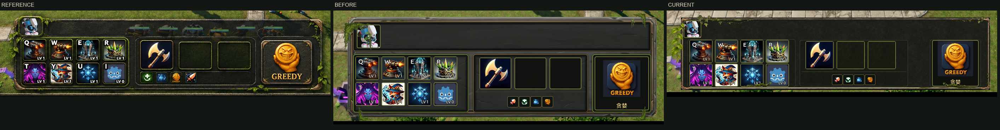

[打开4倍对照](01_frame_4x.png)

### 左侧下垂叶簇

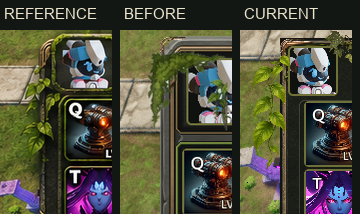

[打开4倍对照](02_left_leaves_4x.png)

### 顶部细藤

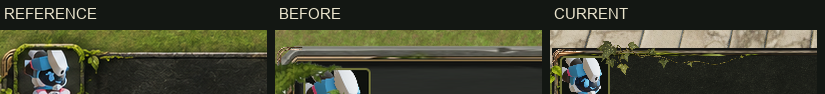

[打开4倍对照](03_top_vine_4x.png)

### 单位缩略图条

[打开4倍对照](04_units_4x.png)

### 技能槽

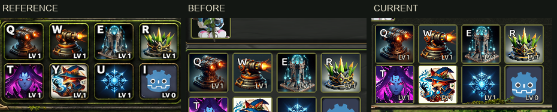

[打开4倍对照](05_skills_4x.png)

### 装备槽

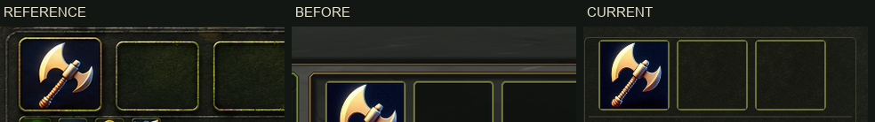

[打开4倍对照](06_items_4x.png)

### Buff区

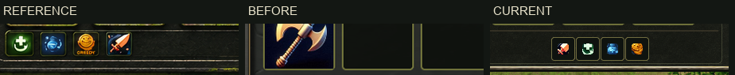

[打开4倍对照](07_buffs_4x.png)

### 玩家天赋卡

[打开4倍对照](08_talent_4x.png)

### 底边苔藓

[打开4倍对照](09_bottom_moss_4x.png)

### 铜角

[打开4倍对照](10_copper_corner_4x.png)

### 顶部头像环

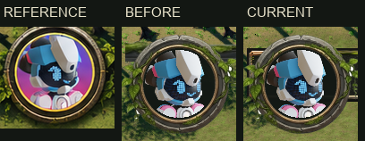

[打开4倍对照](11_avatar_4x.png)

### 波次铭牌

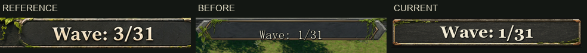

[打开4倍对照](12_wave_4x.png)

### 资源铭牌

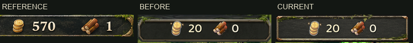

[打开4倍对照](13_resources_4x.png)

### 顶栏整体

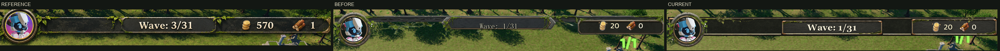

[打开4倍对照](14_header_4x.png)

## 状态与回归

[多选](1080x768_multiselect.png) · [未选中](1080x768_unselected.png) · [单位悬停详情](unit_details.png) · [1920战斗](1920x1080_battle.png) · [2560战斗](2560x1080_battle.png)

- 三种分辨率的底栏高度、槽位可见比例、Tooltip边界检查通过。
- 多选保留两张单位缩略图，未选中隐藏底栏；单位生命变化同步至详情，隐藏停止刷新。
- 叶片视口边界及鼠标穿透断言通过。
- 本轮三次流程循环通过，节点采样均1014，孤立节点为0。最终视觉检查无SCRIPT ERROR／ERROR，保留既有Fox_Mega.tres UID回退警告。
- 具体叶片排列、铜线风化形态、头像环和部分字形仍有可见差异；本记录不把它们标记为95%已验收。参考中的动态单位、数值及未绑定快捷键不作为美术固定内容复刻。

## 可复现与来源

生成素材及完整提示词见 [generated_assets.json](generated_assets.json)，使用内置imagegen；源文件保留，项目引用位于UI/theme/textures。

测量记录见 [metrics.json](metrics.json)。从项目根目录运行 `python docs/ui_concepts/fidelity/build_comparisons.py` 可根据当前实机截图重建对照册；脚本只缩放、裁切、加标签，不生成替代像素。
