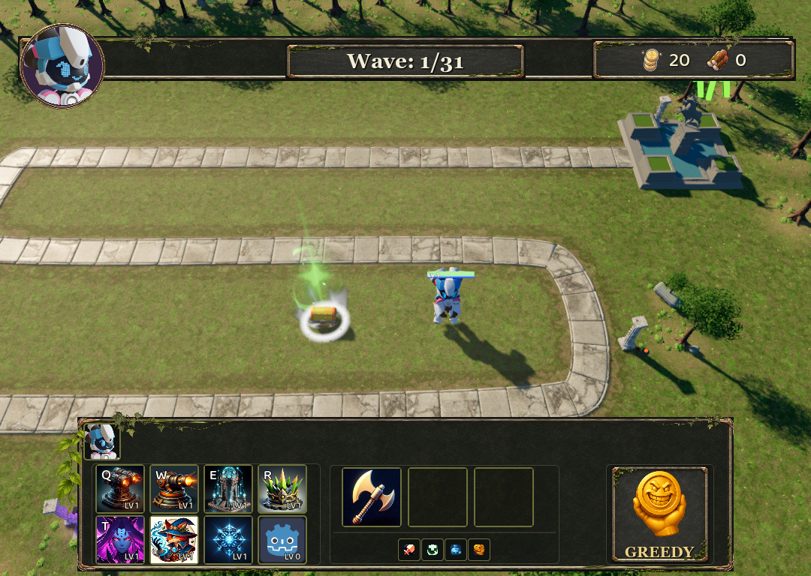

# A 稿对齐：第三轮

本轮聚焦头像铜环、天赋卡和底栏苔藓。实机截图来自原生 Forward+，对照图按底栏宽度统一等比缩放；三列分别为参考、第二轮、当前。没有采用逐元素拉伸来掩盖比例差异。

## 本轮修改

- 头像：独立透明细铜环替换厚重灰石环，扩大角色可见区域，恢复紫色内底。
- 贪婪天赋：独立透明金币与手部图标替换蓝色方底；标题由原生字体绘制，消除图内英文与下方中文重复；卡片接入石材边框和独立悬停样式。中文名称、描述仍保留在 Tooltip。
- 底栏：降低底边与右侧苔藓高度，避让第二行技能等级文字；装饰保持鼠标穿透。
- 保留已有布局：底栏 874×212，技能槽 66×66，装备槽 80×80；技能图标可见宽度占比约 94%。属性仍通过单位悬停查看。

## 逐元素放大对照

每组提供普通尺寸和 4 倍最近邻放大，放大图用于检查边缘，不代表新增画面细节。

|元素|等比对照|4 倍放大|
|---|---|---|
|底栏整体|[查看](01_frame.png)|[放大](01_frame_4x.png)|
|左侧叶片|[查看](02_left_leaves.png)|[放大](02_left_leaves_4x.png)|
|顶部藤蔓|[查看](03_top_vine.png)|[放大](03_top_vine_4x.png)|
|单位条|[查看](04_units.png)|[放大](04_units_4x.png)|
|技能槽|[查看](05_skills.png)|[放大](05_skills_4x.png)|
|装备槽|[查看](06_items.png)|[放大](06_items_4x.png)|
|Buff 槽|[查看](07_buffs.png)|[放大](07_buffs_4x.png)|
|天赋卡|[查看](08_talent.png)|[放大](08_talent_4x.png)|
|底边苔藓|[查看](09_bottom_moss.png)|[放大](09_bottom_moss_4x.png)|
|右下铜角|[查看](10_copper_corner.png)|[放大](10_copper_corner_4x.png)|
|头像环|[查看](11_avatar.png)|[放大](11_avatar_4x.png)|
|波次铭牌|[查看](12_wave.png)|[放大](12_wave_4x.png)|
|资源铭牌|[查看](13_resources.png)|[放大](13_resources_4x.png)|
|顶部整体|[查看](14_header.png)|[放大](14_header_4x.png)|

## 实机与验证

[1920×1080](1920x1080_battle.png) · [2560×1080](2560x1080_battle.png) · [多选](1080x768_multiselect.png) · [未选择](1080x768_unselected.png) · [单位详情](unit_details.png) · [天赋悬停](1080x768_talent_hover.png) · [天赋真实冷却](1080x768_talent_cooldown.png)

`tests/ui_material_review.gd`：三种分辨率、选择状态、单位详情响应与关闭、天赋悬停不跳动、真实冷却显示及恢复全部通过，输出 `UI_MATERIAL_REVIEW_OK`、`TALENT_PRESENTATION_STATES_OK`。日志：`.godot/ui-round3-states.log`。

`tests/game_flow_smoke.gd`：三轮流程通过，`FLOW_TEST_OK`，每轮 nodes=996、orphans=0。日志：`.godot/ui-round3-flow.log`。最终两份运行日志无 SCRIPT ERROR；仍有既存 Fox_Mega.tres UID 回退警告。

## 仍存在的视觉差距

尚不能宣称达到 95% 视觉还原。头像环目前铜边偏细，参考中的双轨铜边和阴影更有体积；天赋卡的圆角铜饰、金币比例和字距仍有差异；叶片的自然疏密、转折与参考尚未逐叶一致。后续应继续围绕这些具体裁片调整，不以功能回归结果替代视觉验收。

字体使用系统字体候选，跨机器字形一致性仍受字体安装情况影响。独立位图通过内置 imagegen 生成；提示词、源文件与项目映射见 [资源记录](generated_assets.json)。对照图由 [确定性裁切脚本](../build_comparisons.py) 生成，几何记录见 [metrics.json](metrics.json)。
