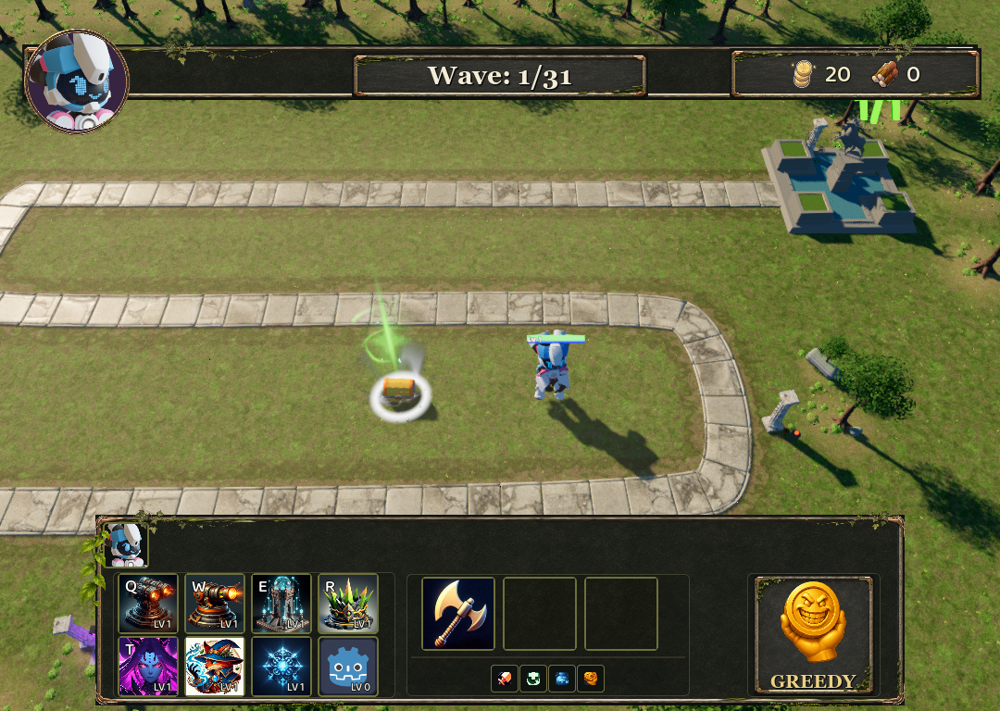

# A 稿对齐：第四轮

本轮补齐天赋卡独立铜角，收紧底栏左侧垂叶与顶部藤蔓。参考、第三轮、第四轮按同一规则等比对照；没有改变槽位和底栏尺寸。

## 已修改

- 新增 `UI/theme/components/talent_card_corners.tscn`：复用现有铜角贴图，四角各 20×20，鼠标穿透；挂载到天赋卡，独立于悬停样式，避免状态切换时消失。
- 左侧垂叶矩形从 54×160 收至 46×142，并向面板收拢 12 像素；顶部藤蔓从 240×54 收至 188×42，减少对单位条的侵入。
- 不修改技能、Buff 或天赋业务逻辑。

## 重点对照

|元素|等比对照|4 倍放大|
|---|---|---|
|左侧叶片|[查看](02_left_leaves.png)|[放大](02_left_leaves_4x.png)|
|顶部藤蔓|[查看](03_top_vine.png)|[放大](03_top_vine_4x.png)|
|天赋铜角|[查看](08_talent.png)|[放大](08_talent_4x.png)|
|完整底栏|[查看](01_frame.png)|[放大](01_frame_4x.png)|

[1920×1080](1920x1080_battle.png) · [2560×1080](2560x1080_battle.png) · [几何记录](metrics.json)

## 验证与剩余差距

原生 Forward+ 执行 `tests/ui_material_review.gd`，退出码 0。三分辨率、天赋悬停与真实冷却、选择状态、单位详情响应检查通过，输出 `UI_MATERIAL_REVIEW_OK`。日志 `.godot/ui-round4-states.log`；保留既存 Fox_Mega.tres UID 回退警告。本轮未重复执行全流程回归。

已检查实际对照图：铜角变化较克制，叶片外伸明显收紧，但叶型、明暗和枝叶转折仍未匹配参考。头像铜环本轮未修改，偏细问题仍待处理；天赋卡的石面层次和弧形包角也仍有差距。当前不认定已达到 95% 还原。
