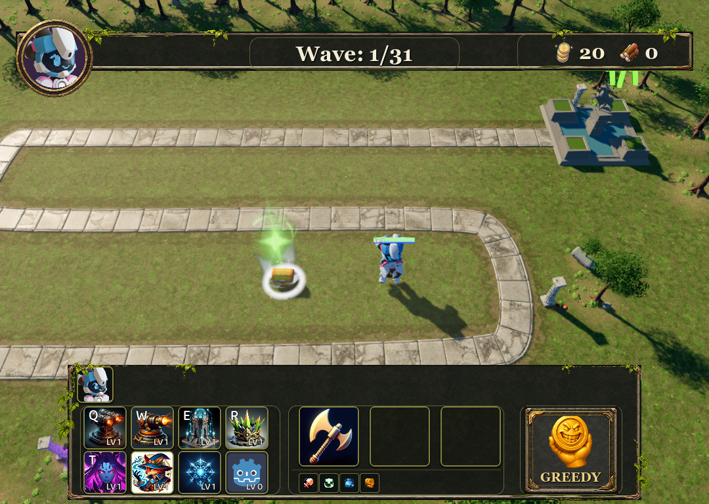

# A 稿对齐：第五轮集中修正

本轮连续进行了素材、实机、局部对照和修正，重点处理第四轮遗留的叶片轮廓、双轨铜环、天赋包角，以及对照中发现的装备槽比例和圆角问题。

## 已落地

- **叶片**：从参考局部通过 imagegen 提取透明垂叶与水平藤蔓，保留上下叶簇、尖叶和短垂须；替换偏褐、稀疏的旧枝条，补齐右侧垂叶。最初生成的稀疏枝条经实机对照后弃用，记录保留。
- **头像环**：采用双铜轨、暗石凹槽和上左高光，调整头像内侧留白；恢复有体积的铜边，避免厚石轮和极细亮线两个问题。
- **天赋卡**：独立透明弧形包角框，实际覆盖卡片外边界；卡片宽度改为 144，保留透明金币、原生标题、中文 Tooltip 与真实冷却。修正 PanelContainer 内容边距导致装饰框错误内缩的问题。
- **装备与 Buff**：装备槽 80→92，横向间隔 16；消除天赋前的多余占位，Buff 从装备左边缘排列。压缩纵向间距后保持底栏 874×212。
- **槽位细节**：7 像素外圆角、细橄榄铜边和轻阴影；使用原生 Panel 的 `clip_children` 裁切图标、空槽石面与冷却层，避免方形贴图盖住圆角。不保留实验中的额外 Shader 圆角逻辑。
- **字体与层级**：顶部波次 32、资源数字 30，统一衬线字形；内部铭牌改为克制细圆边，石材底纹由顶部主面板提供。快捷键 18、等级 12，减少过重描边。
- **单位条**：单位头像 50→56，通过减少上内边距上移，保持技能行位置与总高度。

位图与提示词、源文件、采纳/弃用记录见 [generated_assets.json](generated_assets.json)。最终资源均在 `UI/theme/textures/`，没有引用用户目录中的生成缓存。生成使用内置 imagegen；参考裁切与对照使用确定性图像裁切，最终透明位图由 imagegen 输出。水平藤蔓通过原生 AtlasTexture 去掉外围留白。

## 14 组同尺度对照

三列为参考、第四轮、当前。底栏按可见外框宽度统一等比缩放，保留实际位置差异；禁止单独拉伸元素来掩盖误差。4 倍图使用最近邻放大。

|元素|对照|4 倍|
|---|---|---|
|完整底栏|[查看](01_frame.png)|[放大](01_frame_4x.png)|
|左侧叶片|[查看](02_left_leaves.png)|[放大](02_left_leaves_4x.png)|
|顶部藤蔓|[查看](03_top_vine.png)|[放大](03_top_vine_4x.png)|
|单位条|[查看](04_units.png)|[放大](04_units_4x.png)|
|技能槽|[查看](05_skills.png)|[放大](05_skills_4x.png)|
|装备槽|[查看](06_items.png)|[放大](06_items_4x.png)|
|Buff 槽|[查看](07_buffs.png)|[放大](07_buffs_4x.png)|
|天赋卡|[查看](08_talent.png)|[放大](08_talent_4x.png)|
|底边苔藓|[查看](09_bottom_moss.png)|[放大](09_bottom_moss_4x.png)|
|右下铜角|[查看](10_copper_corner.png)|[放大](10_copper_corner_4x.png)|
|头像环|[查看](11_avatar.png)|[放大](11_avatar_4x.png)|
|波次|[查看](12_wave.png)|[放大](12_wave_4x.png)|
|资源|[查看](13_resources.png)|[放大](13_resources_4x.png)|
|顶部整体|[查看](14_header.png)|[放大](14_header_4x.png)|

[1920×1080](1920x1080_battle.png) · [2560×1080](2560x1080_battle.png) · [多选](1080x768_multiselect.png) · [未选择](1080x768_unselected.png) · [单位详情](unit_details.png) · [悬停](1080x768_talent_hover.png) · [冷却](1080x768_talent_cooldown.png)

## 验收依据

- 原生 Forward+ `tests/ui_material_review.gd`：三种分辨率、选择状态、单位详情响应、悬停无布局跳动、真实冷却均通过。新增断言验证天赋标题避开铜框，铜框与卡片外边界精确重合。日志 `.godot/ui-round5-final.log`。
- 原生 `tests/game_flow_smoke.gd`：三轮 `FLOW_CYCLE_OK`、`FLOW_TEST_OK`，每轮孤立节点 0。日志 `.godot/ui-round5-flow.log`。该回归在最后一次单位头像尺寸调整前运行；最后的布局由上述 UI 专项覆盖。
- 仍有既存 `Fox_Mega.tres` UID 文本路径回退警告。编辑器导入期间的既存插件/Shader 及退出清理错误与原生游戏验收日志分开记录，不能宣称整个工程零警告。
- 对照脚本与 [几何记录](metrics.json) 可复查。以底栏宽度 874 归一化，参考可见外框高约 206.3，实机 206；参考技能宽约 66，实机 66；装备槽宽约 92，实机 92。尺寸吻合不等同于材质相似度。

## 视觉目标状态

主要轮廓和布局差异已集中修正，仍不提供未经验证的“95% 相似度”数字。参考的石材雕刻、局部铜边磨损、苔藓密度与实际生成资源仍有差异；字体也依赖系统候选。此页保留全部裁片用于逐项视觉验收，不能以自动测试通过替代最终审美判断。
