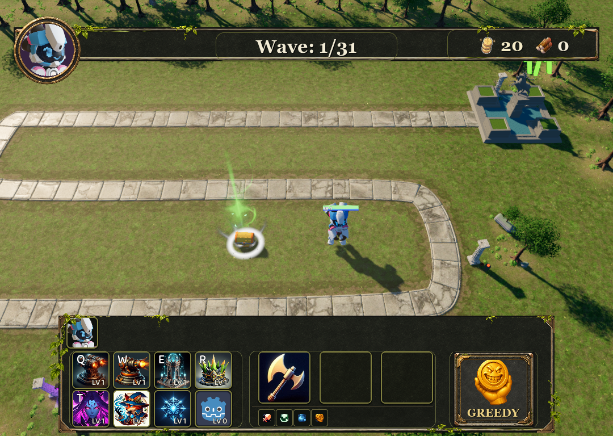

# A 稿对齐：第六轮材质细节

本轮针对第五轮放大图中最明显的两项差距：铜角缺少斜切护片，底边植物被压成连续细条。未改变底栏、技能、装备和天赋布局。

## 修改与证据

- **铜角**：从参考右下角局部提取并恢复双轨铜边、斜切三角护片、凹槽暗部。四角独立复用，按方向翻转；显示范围从 26×26 调整为 32×32，保持鼠标穿透。
- **底边植物**：从参考提取独立尖叶、上下叶簇和细藤，替换压扁的连续苔藓条。右侧叶簇按参考位置缩至 78×24；左侧使用较小的同材质分支，避开技能等级。
- **导入优化**：铜角导入上限 256，水平叶簇 512；原始 PNG 保留。同步调整原生 AtlasTexture 裁切坐标，避免导入尺寸变化后取错区域。
- **对照可读性**：窄裁片增加列留白，解决 REFERENCE / BEFORE / CURRENT 标题重叠；裁片本身没有额外缩放。新增第 15 组右下叶簇对照。

|重点元素|等比对照|4 倍放大|
|---|---|---|
|右下铜护角|[查看](10_copper_corner.png)|[放大](10_copper_corner_4x.png)|
|右下叶簇|[查看](15_bottom_leaf_cluster.png)|[放大](15_bottom_leaf_cluster_4x.png)|
|左侧底边植物|[查看](09_bottom_moss.png)|[放大](09_bottom_moss_4x.png)|
|完整底栏|[查看](01_frame.png)|[放大](01_frame_4x.png)|

其余对照：[左侧垂叶](02_left_leaves.png) · [上沿藤蔓](03_top_vine.png) · [单位条](04_units.png) · [技能](05_skills.png) · [装备](06_items.png) · [Buff](07_buffs.png) · [天赋](08_talent.png) · [头像环](11_avatar.png) · [波次](12_wave.png) · [资源](13_resources.png) · [顶部整体](14_header.png)。同目录均有 `_4x.png` 放大版本。

三列为参考、第五轮、当前。参考和实机按底栏宽度统一等比缩放，4 倍图使用最近邻放大；未按元素拉伸，也未替换实机画面像素。

## 实机验证

原生 Forward+ 执行 `tests/ui_material_review.gd`，最终退出码 0，输出 `UI_MATERIAL_REVIEW_OK`、`TALENT_PRESENTATION_STATES_OK`、`SELECTION_STATES_OK`、`UNIT_DETAILS_REACTIVE_OK`。覆盖 1080×768、1920×1080、2560×1080，天赋悬停、真实冷却、选择状态、Tooltip 与装饰边界及鼠标穿透。最终日志 `.godot/ui-round6-final.log`，无 SCRIPT ERROR 或 ERROR；保留既存 Fox_Mega.tres UID 回退警告。

已查看铜角和叶簇实机裁片及战斗全图。底栏仍为 874×212，技能 66、装备 92，详见 [metrics.json](metrics.json)。本轮为材质与装饰调整，未重复全流程回归；第五轮流程记录保留。

[1920×1080](1920x1080_battle.png) · [2560×1080](2560x1080_battle.png) · [多选](1080x768_multiselect.png) · [未选择](1080x768_unselected.png) · [单位详情](unit_details.png) · [悬停](1080x768_talent_hover.png) · [冷却](1080x768_talent_cooldown.png)

透明素材使用内置 imagegen，提示词、输入、输出和项目路径见 [generated_assets.json](generated_assets.json)。资源位于 `UI/theme/textures/bronze_brace_reference_v6.png`、`UI/theme/textures/bottom_foliage_reference_v6.png`。

## 剩余视觉差距

斜切铜角与叶簇轮廓已补齐，仍有石材刻痕、铜轨接缝与局部苔藓疏密的差异；本轮没有把这些差异标为已解决，也不以功能通过推导 95% 视觉相似度。
