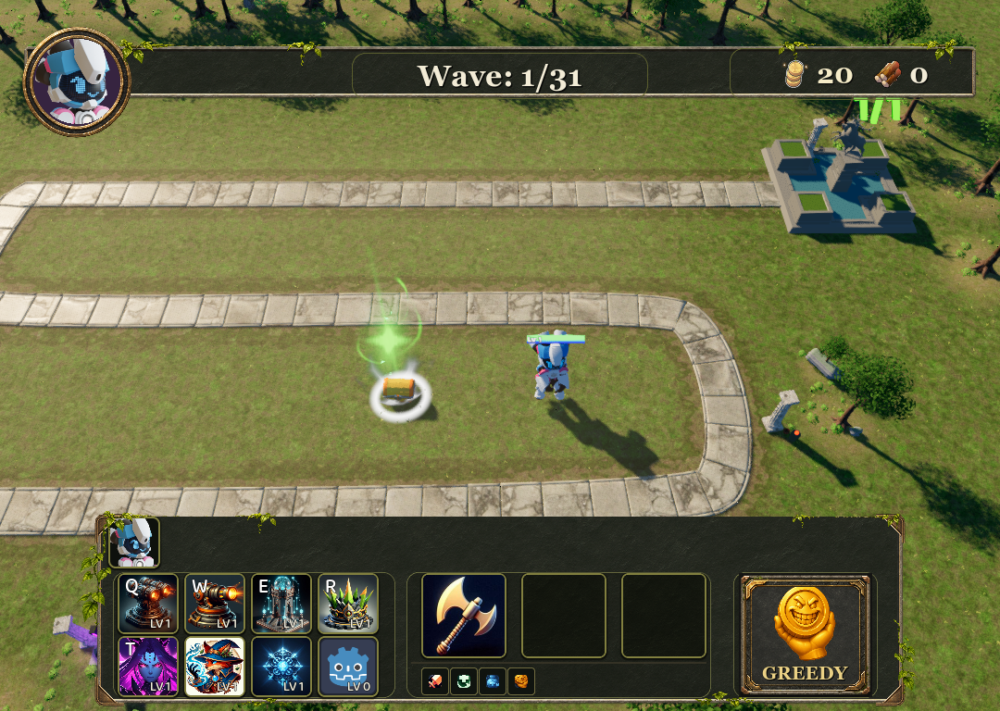

# A 稿对齐：第七轮石材与连续边轨

本轮保持既有布局，修正材质的采样与复用方式。

- **独立石材底板**：新增 `UI/theme/textures/slate_surface_v7.png`，用均匀暗石、细小矿物纹理和浅刻痕替换旧边框内侧的降采样裁片。原生 AtlasTexture 使用完整 512×512 导入图，继续平铺；顶部、底栏及使用该表面的空装备槽同步更新。调整主面板调色以保留细节和文字对比。
- **连续边轨**：顶部与底栏 StyleBoxTexture 改用 TILE_FIT，减少沿长边拉伸纹理。首次实机发现旧贴图烘焙角饰随平铺周期性重复，已另生成去除角饰和植物的 `stone_frame_clean_v7.png`，仅提供连续边轨。四角护片与植物仍使用独立组件。
- **资源**：保留原始 PNG，石材导入上限 512、边轨 256。现有槽位、冷却与技能逻辑未修改。提示词与来源见 [generated_assets.json](generated_assets.json)，生成使用内置 imagegen。

## 重点对照

三列为参考、第六轮、当前。保持统一等比配准，4 倍图为最近邻放大。

|区域|对照|4 倍|
|---|---|---|
|石材表面|[查看](16_stone_surface.png)|[放大](16_stone_surface_4x.png)|
|连续边轨|[查看](17_frame_rail.png)|[放大](17_frame_rail_4x.png)|
|完整底栏|[查看](01_frame.png)|[放大](01_frame_4x.png)|
|顶部整体|[查看](14_header.png)|[放大](14_header_4x.png)|

其余裁片：[左叶](02_left_leaves.png) · [上藤](03_top_vine.png) · [单位](04_units.png) · [技能](05_skills.png) · [装备](06_items.png) · [Buff](07_buffs.png) · [天赋](08_talent.png) · [底边](09_bottom_moss.png) · [铜角](10_copper_corner.png) · [头像](11_avatar.png) · [波次](12_wave.png) · [资源](13_resources.png) · [右下叶簇](15_bottom_leaf_cluster.png)。同目录均提供 `_4x.png`。

## 验证

最终原生 Forward+ `tests/ui_material_review.gd` 退出码 0；1080×768、1920×1080、2560×1080，悬停、真实冷却、选择状态、单位详情、装饰视口边界与输入穿透检查通过，输出 `UI_MATERIAL_REVIEW_OK`。最终日志 `.godot/ui-round7-final.log` 无 SCRIPT ERROR 或 ERROR，仍保留既存 Fox_Mega.tres UID 回退警告。编辑器导入的既存插件与退出清理错误单独记录，不能据此宣称整个工程零警告。

已查看石材、边轨、顶部和战斗实机对照，最终版本未见先前周期性铜三角片。底栏仍为 874×212，详见 [metrics.json](metrics.json)。本轮仅修改材质，未重复全流程回归。

[1920×1080](1920x1080_battle.png) · [2560×1080](2560x1080_battle.png) · [多选](1080x768_multiselect.png) · [未选择](1080x768_unselected.png) · [单位详情](unit_details.png) · [天赋悬停](1080x768_talent_hover.png) · [真实冷却](1080x768_talent_cooldown.png)

## 视觉验收限制

本轮解决了长边拉伸、旧角饰重复和底板复用粗糙裁片的问题。参考的具体刻痕、光照磨损与生成素材仍不逐像素一致，未据此宣称整体 95% 相似度。
