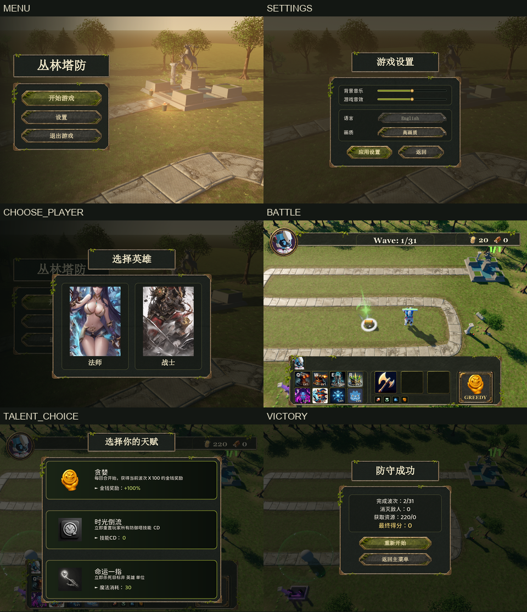

# 第八轮：全页细节与插槽专项

本轮覆盖启动菜单、设置与下拉、角色选择、战斗、天赋选择、Tooltip、胜利与失败结算；插槽按技能、单位、装备、空装备、Buff、天赋六类分别核对。保留现有流程和页面布局。

## 插槽逐项处理

|项目|已处理内容|证据|
|---|---|---|
|线条|技能、单位、装备采用独立薄金属边，保留高光、暗轨和磨损；裁去源图透明外留白，按整图缩放保持圆角连续，避免九宫格切断圆弧|[技能对照](05_skills.png)、[装备对照](06_items.png)|
|内边距|技能、单位、装备均保留 2 像素内容留白；原生圆角裁切同步作用于图标、空槽石面与遮罩|[实测](metrics.json)|
|底纹|空装备槽继续共享独立暗石材，边框与底板分离，未在图标上叠加噪声贴图|[装备放大](06_items_4x.png)|
|横纵间距|技能横 6、纵 2；装备横 16；Buff 横 1→6，避免小图标挤在一起|[Buff 对照](07_buffs.png)、[实测](metrics.json)|
|材质层次|收敛金属调色，避免高光溢出成亮黄色噪点；Buff 小尺寸保留清晰 1 像素线，另配同粗细悬停样式|[Buff 状态](states_buff.png)|
|快捷键与等级|共享加粗拉丁字体，快捷键 18、等级 12；等级改为紧凑的 LV1 字距，保留描边和阴影|[技能状态](states_skill.png)|
|悬停|所有槽位保持位置和尺寸，材质提亮；天赋卡保留独立石框样式，Buff 保持小框粗细|[单位](states_unit.png)、[天赋](states_talent.png)|
|禁用显示|检查图标变暗后文字和边线的可读性；全局禁用控件文字调为暖灰，避免过暗|各槽位状态图中的 DISABLED DISPLAY|
|冷却|技能、装备及天赋遮罩提高对比度，保留快捷键和等级可读性；圆角内裁切，遮罩不跨出槽位|[技能](states_skill.png)、[装备](states_item.png)、[天赋](states_talent.png)|
|输入|装饰、图标和遮罩保持鼠标穿透，交互仍由原槽位根节点处理|专项检查与三轮流程回归|

### 实际尺寸与间距

以下来自原生 1080×768 窗口；三种分辨率均另存测量 JSON。

|类别|外框|图标矩形|留白/说明|
|---|---|---|---|
|技能|66×66|62×62|四侧 2；图标可见宽度约 94%|
|单位|56×56|52×52|四侧 2|
|装备与空装备|92×92|88×88|四侧 2|
|Buff|30×30|26×26|四侧 2；细线 1|
|天赋|144×134|约 89.6×89.6|图标单独居中，上方图标、下方原生标题|

底栏仍为 874×212。外框与图标的完整坐标、技能及装备实际间距见 [metrics.json](metrics.json)，不是从配置值推算。

### 状态放大图

[技能](states_skill.png) · [单位](states_unit.png) · [装备](states_item.png) · [空装备](states_empty_item.png) · [Buff](states_buff.png) · [天赋](states_talent.png)

状态图为实机裁片 3 倍最近邻放大。`DISABLED DISPLAY` 是直接切换槽位呈现状态的显示检查，不代表修改了技能禁用规则。技能和装备的 `MASK PREVIEW` 是固定 50% 遮罩预览，捕捉时暂停槽位计时刷新并验证值稳定；天赋 `REAL COOLDOWN` 来自真实天赋状态切换。单位和空槽没有新增冷却功能。

## 全页逐项核对与修正

|页面/组件|发现的问题与处理|
|---|---|
|共享面板|厚重灰色石块框与战斗风格不一致；换为独立暗石细铜边，统一主菜单、设置、角色选择、天赋与结算|
|标题|字重偏细、叶簇因保持宽高比缩到中间；增加字体字重，分离两端叶簇并固定于标题两侧|
|菜单|保留左侧布局与三个按钮；统一暖金衬线字、暗石背板、细铜护角及植物；[前后对照](page_compare_menu.png)|
|设置|去除偏蓝绿的轨道与焦点色，使用橄榄绿滑轨、原生渐变铜色旋钮，禁用文字适度提亮；[前后对照](page_compare_settings.png)|
|键盘焦点|焦点框不再用不透明色块覆盖按钮表面，保留细暖铜边；实际键盘打开画质下拉并验证可见|
|下拉菜单|统一暗石面板、暖色文字与橄榄悬停；保留现有项目和禁用语言切换行为|
|角色选择|沿用现有角色图、交互与布局，统一面板、标题、内框、叶片与铜角；未修改实际英雄选择逻辑|
|天赋选择|移除三张卡都显示 Godot 占位图的问题，新增可配置 `talent_icon`，场景声明三张真实图标；修正零最小尺寸导致图标不可见的问题；亮绿渐变改为暗色，数值改为克制的浅绿|
|战斗顶栏|核对头像环、波次、资源、藤蔓、文字及铜轨；保留第七轮布局和材质|
|战斗底栏|核对单位条、技能、装备、Buff、天赋、四角与叶簇；本轮重点修正插槽材质和状态表现|
|Tooltip|共享暗石细边、可读文字底板，保留视口钳制、滚动与鼠标处理；单位详情仍响应 HP 变化|
|胜败结算|两种状态分别截取三分辨率实机，统一标题、数据区、按钮与装饰；沿用真实统计字段|

语言切换仍是已有的禁用功能，本轮没有把它包装成已支持的新功能。角色选择场景作为独立页面加载检查，不改变当前主菜单直接开始游戏的既有流程。

## 三分辨率页面交付

|页面|1080×768|1920×1080|2560×1080|
|---|---|---|---|
|主菜单|[查看](pages/1080x768_menu.png)|[查看](pages/1920x1080_menu.png)|[查看](pages/2560x1080_menu.png)|
|键盘焦点|[查看](pages/1080x768_menu_focus.png)|[查看](pages/1920x1080_menu_focus.png)|[查看](pages/2560x1080_menu_focus.png)|
|设置|[查看](pages/1080x768_settings.png)|[查看](pages/1920x1080_settings.png)|[查看](pages/2560x1080_settings.png)|
|下拉|[查看](pages/1080x768_settings_dropdown.png)|[查看](pages/1920x1080_settings_dropdown.png)|[查看](pages/2560x1080_settings_dropdown.png)|
|角色选择|[查看](pages/1080x768_choose_player.png)|[查看](pages/1920x1080_choose_player.png)|[查看](pages/2560x1080_choose_player.png)|
|战斗|[查看](pages/1080x768_battle.png)|[查看](pages/1920x1080_battle.png)|[查看](pages/2560x1080_battle.png)|
|Tooltip|[查看](pages/1080x768_tooltip.png)|[查看](pages/1920x1080_tooltip.png)|[查看](pages/2560x1080_tooltip.png)|
|天赋选择|[查看](pages/1080x768_talent_choice.png)|[查看](pages/1920x1080_talent_choice.png)|[查看](pages/2560x1080_talent_choice.png)|
|胜利|[查看](pages/1080x768_victory.png)|[查看](pages/1920x1080_victory.png)|[查看](pages/2560x1080_victory.png)|
|失败|[查看](pages/1080x768_defeat.png)|[查看](pages/1920x1080_defeat.png)|[查看](pages/2560x1080_defeat.png)|

## 参考对照与测试

本目录保留 01—17 组“参考 / 第七轮 / 当前”裁片及对应 `_4x.png`。重点：[技能](05_skills.png)、[装备](06_items.png)、[Buff](07_buffs.png)、[天赋](08_talent.png)、[整体](01_frame.png)、[顶部](14_header.png)。截图与状态图均来自原生渲染，裁切工具不生成 UI 像素。

- `tests/ui_material_review.gd` 扩展到所有页面与槽位状态，输出 `SLOT_STATES_OK`、`ALL_UI_PAGES_OK`、`UI_MATERIAL_REVIEW_OK`。检查真实冷却恢复、悬停不跳动、非零天赋图标及视口边界、键盘打开下拉、选择状态与单位详情响应。
- `tests/game_flow_smoke.gd` 三轮流程通过，`FLOW_TEST_OK`，三轮孤立节点均为 0。
- 最终日志：`.godot/ui-round8-final.log`、`.godot/ui-round8-flow.log`。保留既存 Fox_Mega.tres UID 回退警告；编辑器导入的既存退出清理问题另存，不宣称整个工程零警告。
- [素材及完整提示词](generated_assets.json)：本轮位图使用内置 imagegen，运行时均引用项目内资源；旋钮为原生 GradientTexture2D。其他铜角、植物和图标复用已有资源。
- [页面与状态裁切脚本](../build_page_review.py)、[参考对照脚本](../build_comparisons.py) 可重复运行。文档目录有 `.gdignore`，验收截图不参与游戏资源导入。

## 视觉验收边界

线条、纹理、间距、圆角、字形、留白和状态均已逐项核对并处理，以上状态表说明了实际覆盖范围。参考里的具体磨损、植物形态和图标绘画风格仍不能保证逐像素相同，系统字体也存在跨机器差异；不把这些功能测试或尺寸数据换算为未经验证的“整体 95% 相似度”。
