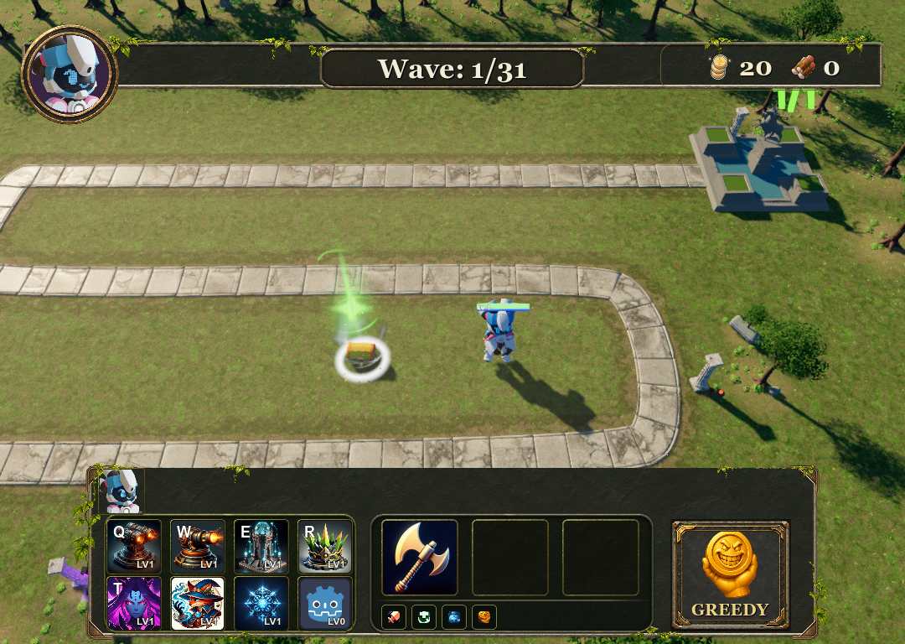

# 第九轮：Action Bar 次级容器与 Wave 铭牌

本轮针对次级容器的边框、石材纹理、边距、分区层次，以及上方 Wave 的边框与装饰。没有修改技能或装备业务逻辑。

## Action Bar 内部分区

- **技能区**：独立的圆角内凹石框，包含灰铜双轨、暗槽、局部磨损高光和低对比石纹；略偏橄榄色，与技能槽的细金属边分层。分区框上沿上提，使首行槽位与外边轨之间留出 8 像素。技能横向间隔从 6 调到 10，修正原来左侧紧、右侧空的情况。
- **装备/Buff 区**：共享同套内凹石框，色调更克制。宽度 329→343，补足第三个装备槽右侧留白；移除零宽占位节点，消除该节点额外产生的一段 HBox 间隔。装备和 Buff 的左起点保持一致。
- **分隔线**：原来的实色粗线换为两端淡出的细灰铜线，与石框内槽衔接。
- **天赋区**：移除外层次级容器的额外描边，保留天赋卡本身的铜角和石框，避免三层重复边线。卡片仅随修正后的分区整体右移 2 像素。
- **层级**：选中单位条保持前景，分区框绘制范围上移时不会盖住单位头像。

新样式独立于菜单共享样式：`UI/theme/styles/action_skill_inset.tres`、`action_item_inset.tres`。两者复用 `action_inset_reference_v9.tres` 的纹理；材质不包含图标、文字或插槽。次级分区的磨损与边轨就是装饰，不额外铺满叶片或主面板护角。

### 原生实测

|项目|当前值|
|---|---|
|底栏|874×212|
|技能区布局范围|305×136|
|技能区边框绘制范围|305×146，上下通过样式扩展|
|技能区首行上留白|8|
|技能区左右留白|约 5 / 6|
|技能间距|横 10、纵 2|
|装备/Buff 区布局范围|343×136|
|装备/Buff 区边框绘制范围|343×146|
|装备区左右留白|约 16 / 19|
|装备间距 / Buff 间距|16 / 6|
|技能槽 / 装备槽|66×66 / 92×92|

控件布局范围与样式绘制范围分别记录，避免把绘制扩展误认为控件尺寸。完整坐标、图标边界和 Wave 范围见 [metrics.json](metrics.json)。天赋挂载容器使用 StyleBoxEmpty，其记录范围不代表存在可见边框。

## Wave 铭牌

- 替换原来的一条均匀绿色圆线，改为独立的长圆角/斜切石质铭牌。
- 表面包含连续灰铜边轨、凹槽暗部、局部磨损高光和暗石浅刻痕；颜色与主顶栏拉开轻微层次。
- 左右连接处各有小叶簇，复用既有植物素材，鼠标穿透，不盖住中间原生文字。
- 铭牌从 320×50 调到 320×52，原生 Wave 文字和波次数值逻辑保留。

资源为 `UI/theme/styles/panel_wave_plaque.tres`、`UI/theme/components/wave_plaque_garnish.tscn`，材质输入为空铭牌，不含烘焙文字。

## 逐元素对照

三列为参考、第八轮、当前。按框宽统一等比配准，未单独拉伸裁片。Wave 裁切范围本轮扩展到两侧叶簇，避免原来裁片截掉右端边框。

|重点|等比对照|4 倍放大|
|---|---|---|
|技能区次级框|[查看](18_skill_inset.png)|[放大](18_skill_inset_4x.png)|
|装备/Buff 次级框|[查看](19_item_inset.png)|[放大](19_item_inset_4x.png)|
|天赋挂载与层级|[查看](20_talent_mount.png)|[放大](20_talent_mount_4x.png)|
|Wave 铭牌与叶饰|[查看](12_wave.png)|[放大](12_wave_4x.png)|
|整体底栏|[查看](01_frame.png)|[放大](01_frame_4x.png)|
|顶部整体|[查看](14_header.png)|[放大](14_header_4x.png)|

其余 01—20 裁片保留在同目录。[1920×1080 实机](1920x1080_battle.png) · [2560×1080 实机](2560x1080_battle.png) · [多选](1080x768_multiselect.png) · [未选择](1080x768_unselected.png)。

## 验证

- 原生 Forward+ `tests/ui_material_review.gd`：三分辨率、槽位状态、全页加载、真实天赋冷却、选择与 Tooltip 检查通过，退出码 0，输出 `UI_MATERIAL_REVIEW_OK`。新增检查确保次级框的绘制范围在底栏内，Wave 叶饰在视口内并保持鼠标穿透。
- 原生 `tests/game_flow_smoke.gd`：三轮 `FLOW_CYCLE_OK`、`FLOW_TEST_OK`，孤立节点均为 0。
- 最终日志 `.godot/ui-round9-final.log`、`.godot/ui-round9-flow.log`。仍有既存 Fox_Mega.tres UID 回退警告；不宣称工程零警告。
- 已查看次级框、Wave 和整页实机对照。新增位图使用内置 imagegen，均存于项目资源目录，提示词、参考输入及生成来源见 [generated_assets.json](generated_assets.json)。导入上限 512，外部透明留白使用原生 AtlasTexture 裁切。

本轮针对明确的容器与铭牌差距；具体刻痕和磨损仍有自然材质差异，不将功能回归或几何测量换算成未经验证的整体相似度。
