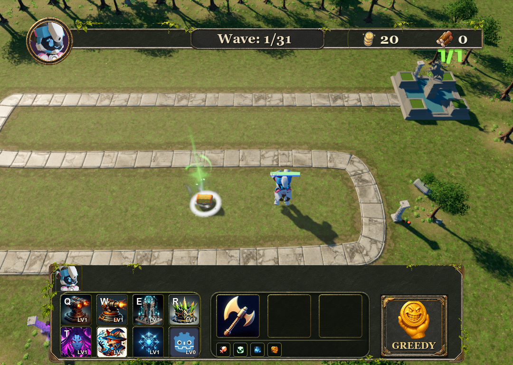

# 第十轮：统一比例与四角轮廓复核

## 先修正对照基准

前轮顶部裁片按控件自身宽度归一化，会掩盖尺寸差异。本轮顶部与底栏统一使用 **0.874** 参考缩放倍率；修改前、当前实机保持原生像素尺寸，不按控件单独缩放宽高。旧顶部对照适合查看材质，不应作为尺寸一致的证明。

顶部完整参考区域按界面中心定位，保留头像、Wave、资源组之间的相对位置。动态数字和战场内容不参与形状判断。

## 已修改

- **Wave 比例**：320×52→286×48。手工标注的参考铭牌可见范围约 326×56，按统一倍率约为 285×49；整数像素取整后当前尺寸接近该范围。字体 32→28，并修正暖白色和光学对齐。
- **Wave 四角与材质**：重新从参考局部提取空铭牌，保留上下不同的斜切/圆弧过渡、弱高光和不规则磨损；替换偏光滑、偏亮的版本。最终按固定尺寸整体采样，避免小高度下角片挤压。文字仍由原生 Label 绘制。
- **次级容器转角**：沿用已确认的石材，改用固定 20 像素角片，避免 305 与 343 两种宽度将同一转角拉成不同椭圆。这里的 20 是切片边界，不等同于宣称参考数学半径为 20。
- **头像**：128×128→108×108，按统一基准调整左锚点与内侧留白。金属圈保持正圆，内部圆形图片与环的开口衔接。
- **顶部连接**：背景边轨、Wave 和资源组均为 48 像素高；收紧顶栏左右范围，调整叶饰连接位置与资源组锚点。金币、木材为常见数值位数预留固定空间，减少数字变化引起的图标移动。
- **验证稳定性**：一次并行运行发生键盘下拉检查失败。已停止采用该次截图，测试在发送按键前显式取得窗口与控件焦点，并串行重新运行；最终输出均来自重新通过的检查。

## 四角放大与边缘叠图

|组件|四角复核|整体对照|
|---|---|---|
|Wave|[四角与叠图](curves_wave.png)|[参考 / 前 / 后](12_wave.png)|
|技能次级框|[四角与叠图](curves_skill.png)|[参考 / 前 / 后](18_skill_inset.png)|
|装备/Buff 次级框|[四角与叠图](curves_item.png)|[参考 / 前 / 后](19_item_inset.png)|
|顶部整体|[头像对照](11_avatar.png)|[整组对照](14_header.png)|

四角图从左至右：参考、第九轮、当前、边缘叠图；从上至下：左上、右上、左下、右下。每角取 32×32 原生像素，再做 4 倍最近邻放大。

叠图青色为参考灰度边缘，红色为当前边缘，接近白色表示局部边缘重合。**图中也包含纹理、叶片和图标边缘，不是纯几何误差图，更不是相似度分数。** 四角以各自标注框的角点配准，用于检查形状；位置与整体尺寸另看完整对照和测量 JSON。

参考边界为从位图中手工选取的可见范围，部分轮廓受植物遮挡，不能当成完整矢量轮廓真值。

## 实测与资源

完整控件边界、分区绘制范围、顶部锚点和图标区域见 [metrics.json](metrics.json)。

|项目|当前|
|---|---|
|Wave|286×48|
|Wave 字号|28|
|头像容器|108×108|
|资源组|288×48|
|顶栏背景边轨|960×48（1080 宽窗口）|
|次级框角片|20，随容器宽度保持角片尺寸|
|底栏|874×212|
|技能槽 / 装备槽|66×66 / 92×92|

原生资源：`UI/theme/styles/panel_wave_plaque.tres`、`action_skill_inset.tres`、`action_item_inset.tres` 以及 `UI/ui.tscn`。Wave 新位图使用内置 imagegen；次级框复用原位图并调整原生导入与切片配置。生成提示词、输入裁片和采纳/弃用记录见 [generated_assets.json](generated_assets.json)。

脚本：[统一尺度对照](../build_comparisons.py)、[四角复核](../build_curve_review.py)。本目录保留 01—20 的对照图及 `_4x.png`，未修改原生截图像素来制造一致效果。

[1920×1080](1920x1080_battle.png) · [2560×1080](2560x1080_battle.png) · [多选](1080x768_multiselect.png) · [未选择](1080x768_unselected.png)

## 验证与结论边界

- 原生 Forward+ `tests/ui_material_review.gd` 最终串行运行退出码 0，三分辨率检查、槽位状态、真实天赋冷却、选择、Tooltip 与全页检查通过，输出 `UI_MATERIAL_REVIEW_OK`。
- 新增检查确保 Wave、资源组、顶栏边轨等高，文字容器与叶饰不越界。
- 原生 `tests/game_flow_smoke.gd` 三轮 `FLOW_CYCLE_OK`、`FLOW_TEST_OK`，孤立节点均为 0。
- 最终日志 `.godot/ui-round10-final.log`、`.godot/ui-round10-flow.log`；仍有既存 Fox_Mega.tres UID 回退警告，编辑器导入退出问题另记，不宣称整个工程零警告。

已修正可验证的尺寸、拉伸和轮廓过渡问题，但叠图仍可见局部边线、自然磨损和植物形态差异。**当前不能诚实标记为逐像素“完美一致”。** 功能回归通过不替代视觉一致性验收。
