# 丛林塔防 · 苔石幽绿 UI 全套概念稿

本套以用户指定融合稿及功能对齐稿为基础，使用内置 imagegen 生成原创界面视觉。保留现有游戏场景、技能图标和操作区关系，统一为深色石材、细铜边与克制玉绿高亮。

这些文件是设计概念图，不是游戏运行截图或已经接线的 Godot 控件。游戏代码未因图稿生成而修改。

## 页面索引

| 页面 | 功能依据与边界 |
|---|---|
| [01 主菜单](01_main_menu.png) | 开始游戏、设置、退出；不新增读档与商店 |
| [02 角色选择](02_choose_player.png) | 现有法师、战士两种选择；不新增解锁或付费角色 |
| [03 战斗：未选中](03_battle_idle.png) | 波次、金币、木材；无选中单位时收起操作栏 |
| [04 战斗：单选](04_battle_selected.png) | 技能、装备、Buff、玩家天赋；属性摘要为新增展示建议 |
| [05 战斗：多选](05_battle_multiselect.png) | 单位缩略图独立成行，技能仍显示当前活动单位的技能 |
| [06 技能详情与施法](06_skill_tooltip.png) | 利用已有技能详情、费用信息及建造范围指示能力 |
| [07 装备与状态详情](07_item_buff_tooltip.png) | 装备槽、拖动和 Buff 状态；不引入商店或新的装备类型限制 |
| [08 天赋选择](08_talent_selection.png) | GREEDY、COOLDOWN、SHUTDOWN；保持现有三选项 |
| [09 设置](09_settings.png) | 音乐、音效、画质；语言禁用；应用保存、返回取消 |
| [10 胜利结算](10_victory.png) | 波次、击杀、资源、得分；重新开始、主界面 |
| [11 失败结算](11_defeat.png) | 沿用结算结构，不增加复活付费或奖励系统 |

## 图稿预览

### 01 主菜单
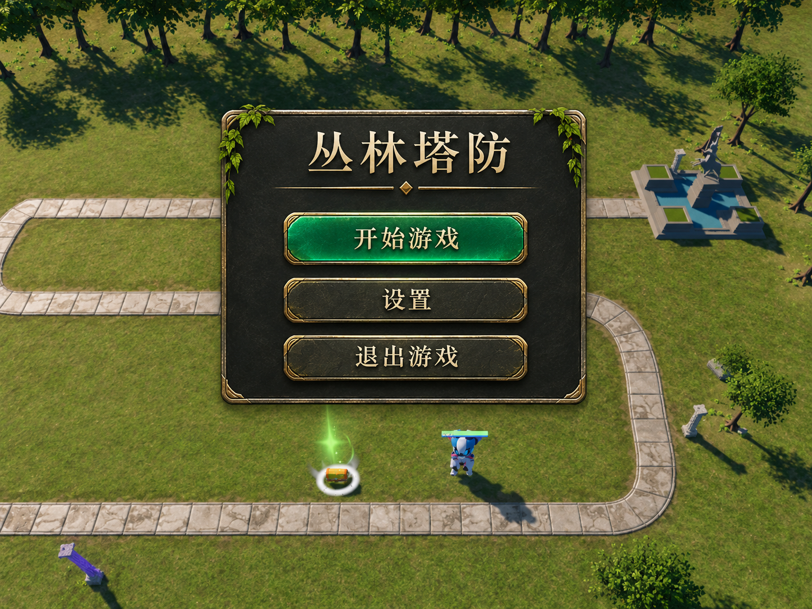

### 02 角色选择
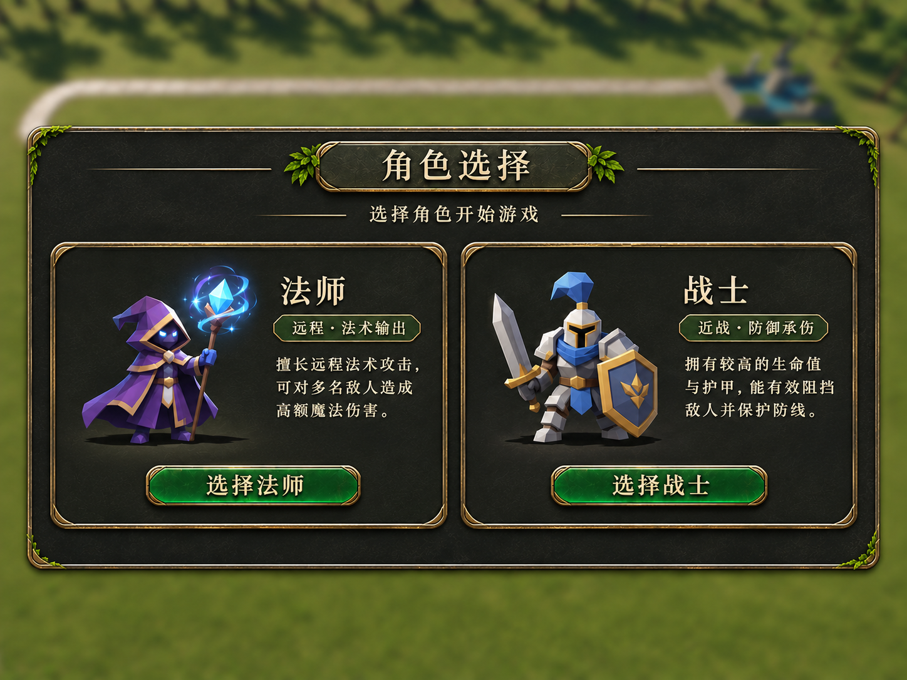

### 03 战斗：未选中
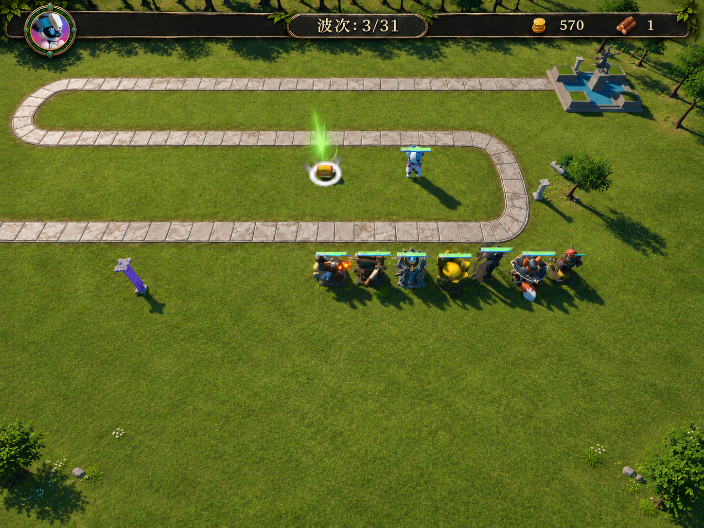

### 04 战斗：单选
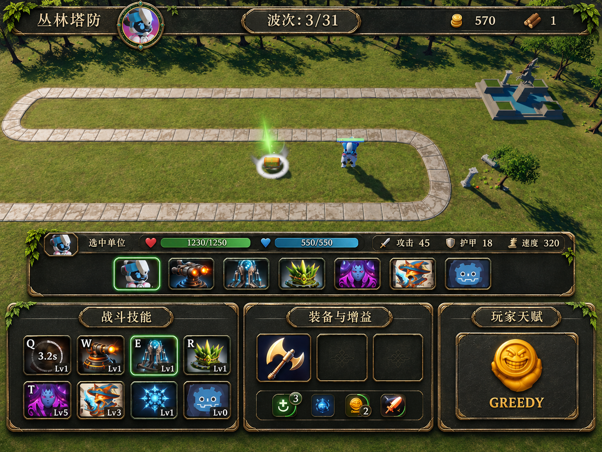

### 05 战斗：多选
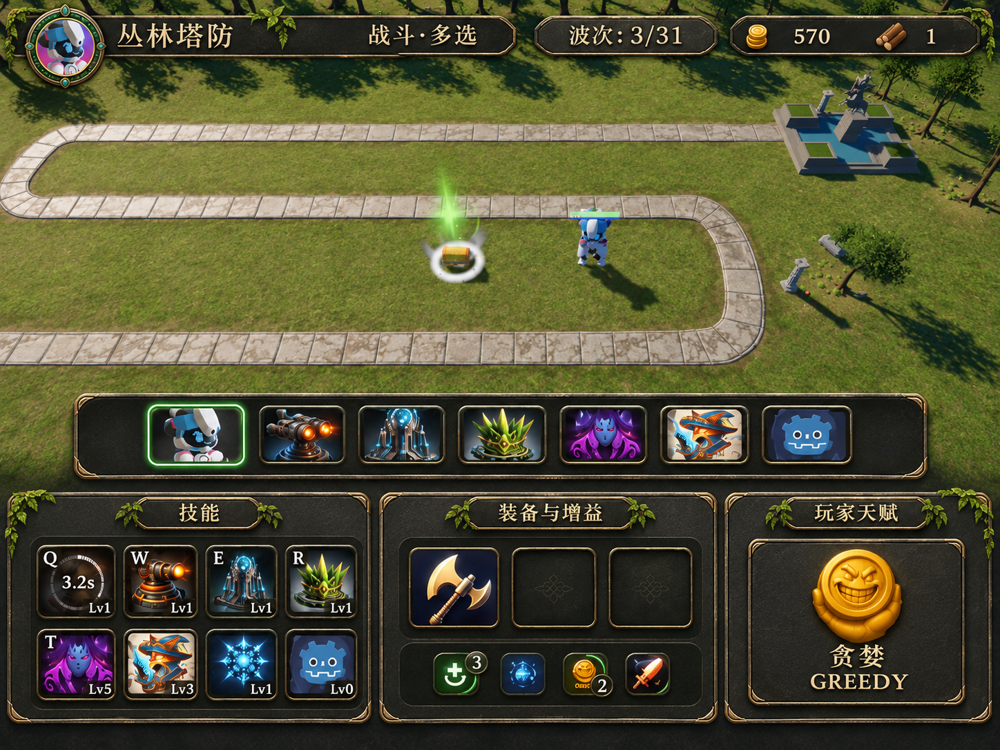

### 06 技能详情与施法
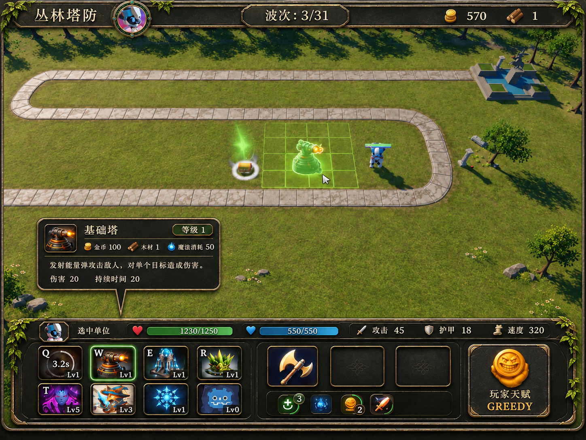

### 07 装备与状态详情
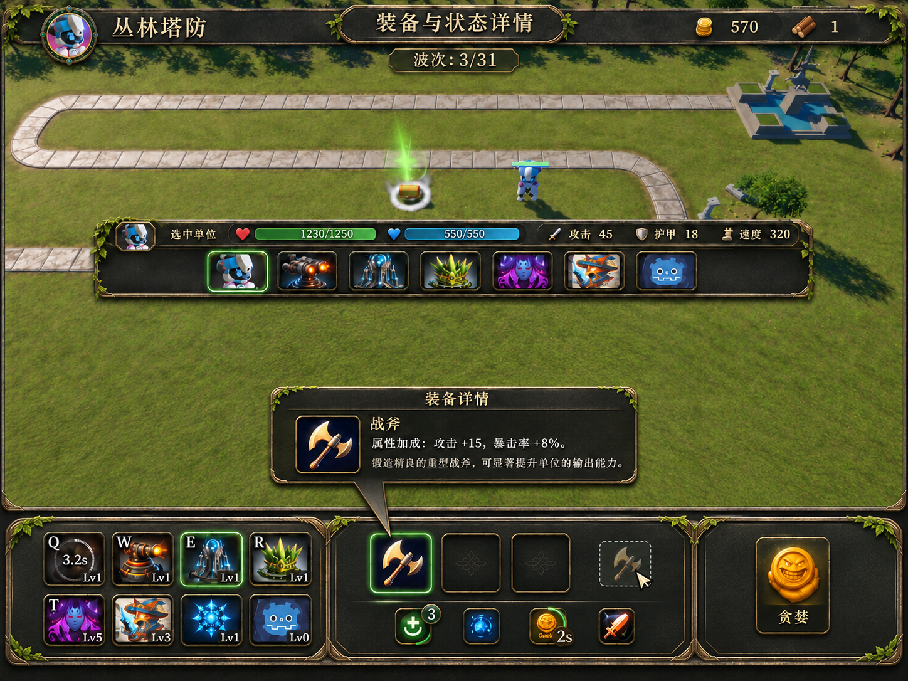

### 08 天赋选择
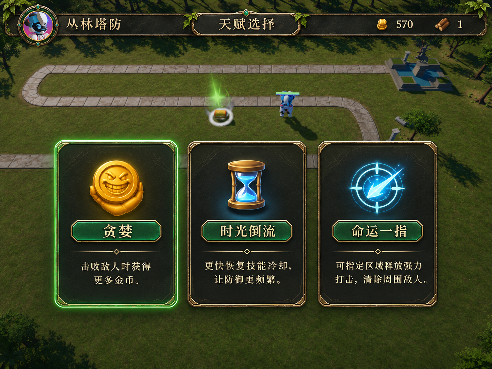

### 09 设置
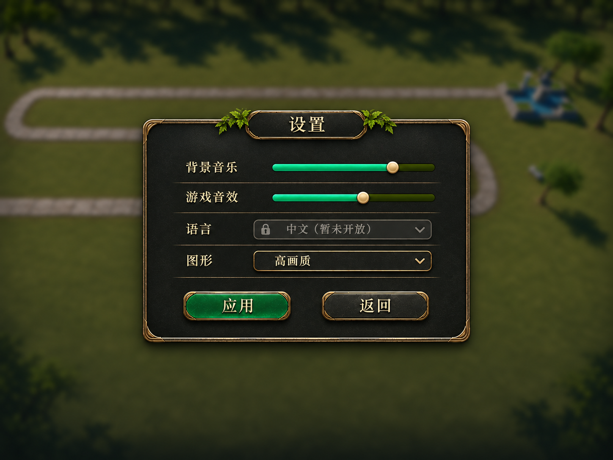

### 10 胜利结算
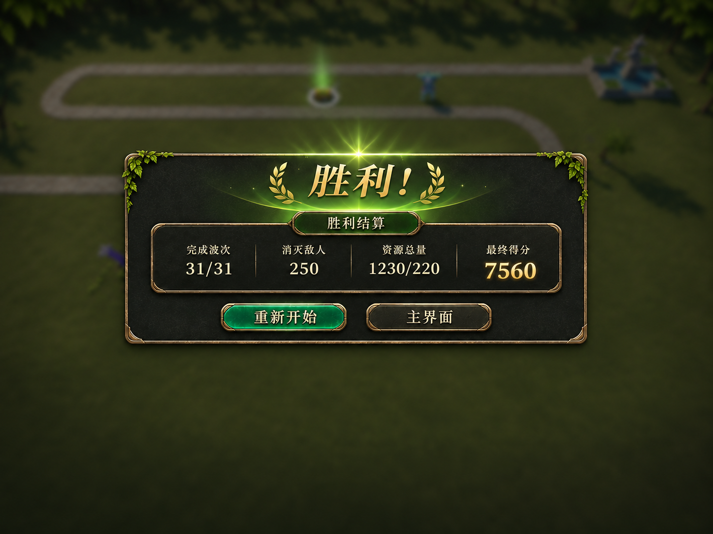

### 11 失败结算
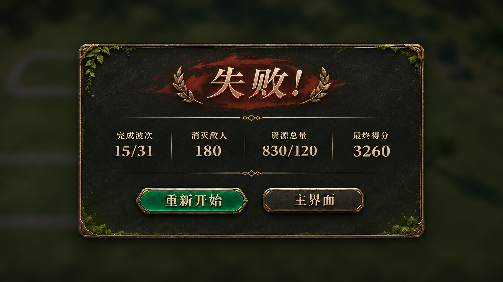

## 实装约束

- 本套已逐页检查并修正选人、未选中战斗、技能详情、物品详情、设置和结算中的跨页面面板混入。仍保留概念图的布局差异：04/05 底栏偏大，07 单位条与底栏之间的距离偏大；正式实现统一收紧为底部整体，不能照搬这些比例。
- 角色造型、角色定位说明、天赋效果描述和物品加成均是视觉占位示例。最终必须读取当前资源，不能按图中文字修改数值或玩法。特别是天赋效果不能从生成的描述推断。

- 战斗顶部维持头像、波次、金币与木材；底部保持左技能、中装备与 Buff、右玩家天赋。多选缩略图不得被属性摘要替代。
- 当前默认技能键位仅 Q/W/E/R/T，不能照生成图自行添加未绑定按键。槽位数量由实际数据决定，图中数量不是新的系统上限。
- 生命、法力和属性摘要需绑定现有属性数据；图中数值均为示例，不新增战斗规则。默认不展示没有数据来源的字段。
- 冷却数字、等级、禁用、层数和持续时间以运行状态驱动；常驻 Buff 不伪造倒计时。Tooltip 需要避开实际点击区域。
- 玩家天赋名称与描述以资源文本为准：GREEDY 贪婪、COOLDOWN 时光倒流、SHUTDOWN 命运一指；图像生成中的字形和文案不是字符串来源。
- 不新增暂停菜单、倍速、连续波次进度条、小地图、商店、技能树、战役选关和载入存档页面。已有代码片段或配置项不代表对应 UI 已实现。
- 未单独设计启动器或加载系统；主菜单是当前启动入口。屏幕震动虽有配置，但设置页尚未绑定，概念稿不将其呈现为可用控件。
- 沿用当前界面的主流程：主菜单→角色选择→战斗→胜负结算；天赋选择为战斗内功能。设置入口及返回逻辑沿用现有实现。
- 字体、文字与控件正式落地时使用 Godot 原生 UI；石材框使用可伸缩资源，不能把整张概念图直接当可交互界面。
- 先在当前 1080×768 检查可读性与遮挡，再适配宽屏；纹理细节不得压过文字与战场。生成图上的不同尺寸和局部排版差异需在统一 Theme 中收敛。
- 本套不是可直接商用的完整切图包。实际项目素材、字体和图标的许可需逐项核查，不因出现在概念图中自动获得授权。

## 生成记录

原始提示词按页面保存在 `prompts.json`，源生成文件路径记录在 `manifest.json`。保留原始生成文件，项目图稿使用复制件。
