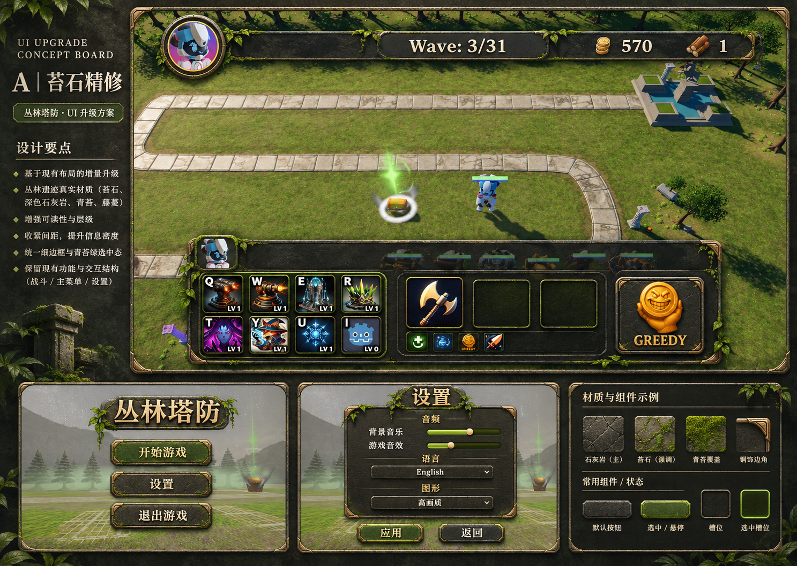
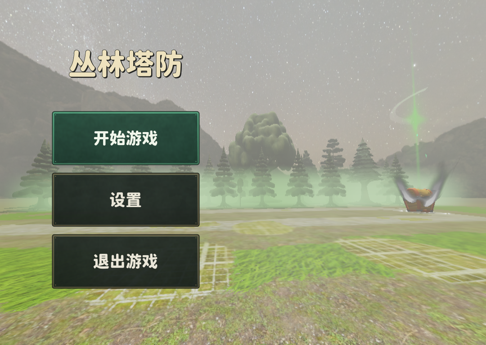
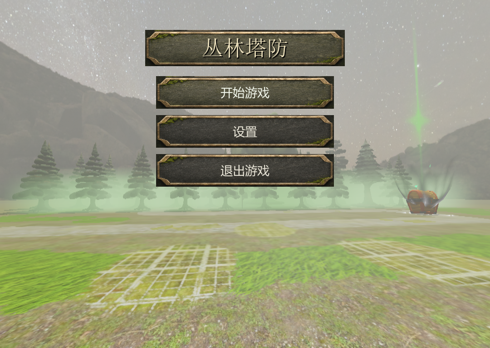
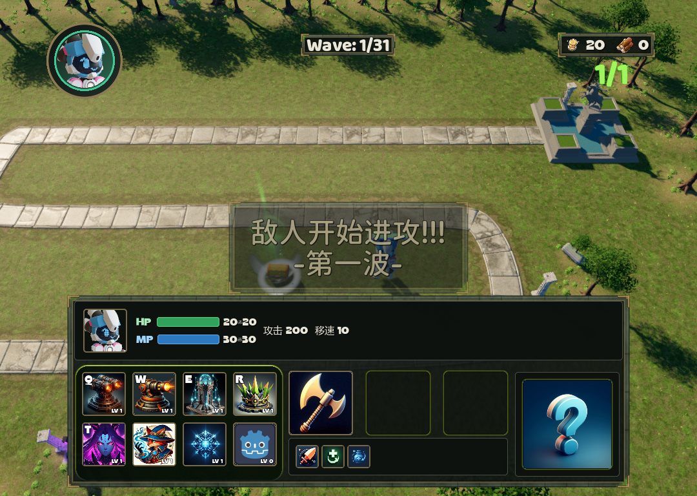
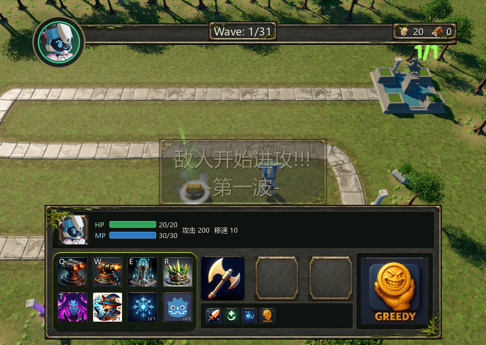

# A「苔石精修」实机材质对齐

本轮最终视觉基准为用户指定的 A 稿，不再沿用偏亮的厚铜框、浓绿玉石按钮方向。以下图片均明确区分概念参考与真实运行截图。

## 参考与实机



| 页面 | 本轮修改前 | 本轮修改后：Forward+ 实机 |
|---|---|---|
| 主菜单 |  |  |
| 战斗单选 |  |  |

[1080 设置](1080x768_settings.png) · [1080 Tooltip](1080x768_tooltip.png) · [1920 战斗](1920x1080_battle.png) · [2560 战斗](2560x1080_battle.png) · [2560 Tooltip](2560x1080_tooltip.png)

## 已实装

- 主面板替换为新生成的灰黑石材、细哑铜边、自然裂隙与局部苔藓，保持文字区域低对比。
- 按钮改为一套共享六状态图集，通过 AtlasTexture 取样后使用九宫格；常态为灰石，悬停为苔绿，取消亮金多层轨道。
- 主菜单保留原有三个动作，改为居中的紧凑按钮组；标题使用石材铭牌与衬线字体。
- 战斗顶部增加穿透鼠标的整体石材底框，保留头像、波次、金币和木材的数据来源及功能。
- 底栏补自然苔藓角饰，维持原有技能、装备、Buff 与天赋顺序；空装备槽去除旧全控件着色器，恢复独立槽位边框。
- 共用字体资源收敛圆体带来的风格差异。标题使用系统衬线字体候选，正文使用系统无衬线候选；没有复制或分发操作系统字体文件。不同平台的字体外观可能不同，发行版应确定有授权的固定字体文件。
- 生成素材由 Godot 导入器缩小至适合 UI 的像素尺度；九宫格边缘使用拉伸，避免烘焙在边缘的苔藓反复平铺。独立角饰不处理输入。

## 验证与边界

- Forward+ 三轮 `game_flow_smoke.gd`：退出码 0、`FLOW_TEST_OK`、三轮孤立节点均为 0。
- `ui_material_review.gd`：1080×768、1920×1080、2560×1080，菜单、设置、单选战斗与 Tooltip 共 12 张实际截图；底栏和 Tooltip 的边界断言通过，输出 `UI_MATERIAL_REVIEW_OK`。
- 两项最终运行日志均未出现 SCRIPT ERROR 或 ERROR。仍有既有 `Fox_Mega.tres` 资源 UID 回退警告。
- 图中数值和波次是运行时状态，不是固定美术文字。概念稿的未实现按钮、额外快捷键和伪造数据没有加入。
- 这是实机对齐迭代，不把风格相近宣称为逐像素复刻。原有角色与技能插画、场景灯光保持游戏资产本身；概念稿中的插画细节不是本轮替换范围。
- 编辑器导入阶段出现了已有插件/Headless Shader 与退出清理日志；这些不计入原生运行零错误结论，记录保留于 `.godot/ui-material-v2-import.log` 和 `.godot/ui-material-v3-import.log`。

## 素材与生成记录

使用内置 imagegen。最终面板源文件为 `exec-553b82d3-3d6b-4d5f-a974-149b2c8fab9e.png`，按钮图集源文件为 `exec-ac09e7a4-8cfb-4f17-9a35-c0d6426810f0.png`，透明苔藓源文件为 `exec-ff9ee2eb-37dc-474d-9b48-c214470190fc.png`；原图保留在本会话 generated_images 目录，项目引用均在 `UI/theme/textures/`。

提示方向：以用户 A 稿为参考；灰黑花岗岩、低噪文字区、单道细哑铜嵌边、轻微切角；植物仅在外角，按钮六状态保持相同轮廓；苔藓角饰单独生成透明背景。未采用早期过亮厚铜版本。

复现视觉检查：

```powershell
& 'H:\Godot\Godot_v4.7.2-stable_mono_win64\Godot_v4.7.2-stable_mono_win64_console.exe' --path . --resolution 1080x768 --script tests/ui_material_review.gd
```
