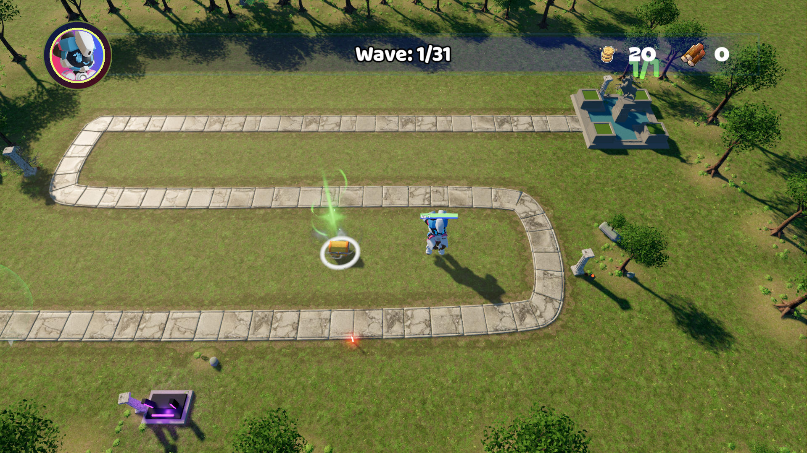
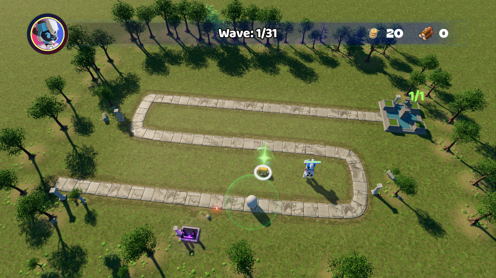
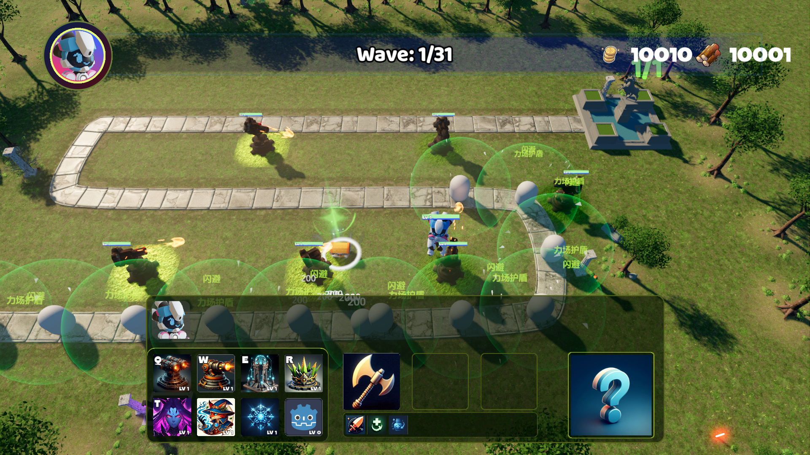
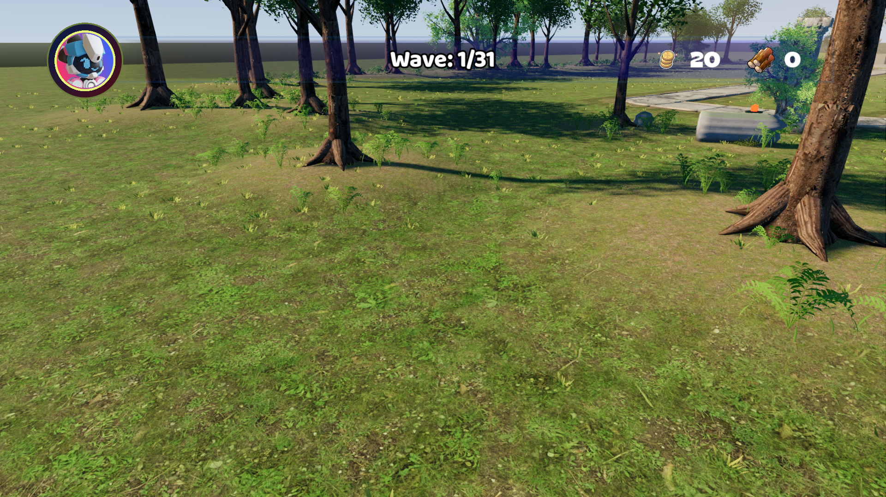

# TD-Demo 场景、成熟树与战斗可读性验收

唯一主工程为 `H:\Godot\Projects\TD-Demo`，入口为 `Main.tscn`。本轮在原资源路径更新成熟树、镜头、草地和护盾，合入此前地形与接地改进，保持180个塔位、现有界面和玩法。截图与数据使用固定文件名，临时输出为 `.godot/scene_review`。

## 参考与当前实机

视觉基准为2026-11-11晚间生成的 [整体概念图](docs/references/concept_overview.png) 和 [树木、草地、高差细节图](docs/references/concept_detail.png)。这些是预期效果，图中塔、基地和HUD的生成差异不作为替换依据。







| 窗口 | 六塔交战截图 |
|---|---|
| 1080×768 | [查看](render_v10/captures/viewport_1080_768.png) |
| 1920×1080 | [查看](render_v10/captures/viewport_1920_1080.png) |
| 2560×1080 | [查看](render_v10/captures/viewport_2560_1080.png) |

交战样本通过现有单位系统和建造技能动作生成6座Cannon1，并加入12个首波同资源敌人。正常建造预览、费用和升级由流程及画质回归另行覆盖。敌人移动、伤害数字和技能特效随时间变化。

## 实际改动

- 镜头为透视投影、垂直FOV 54°、俯角55°、高度36米，观察点为(6,0,−3)。关闭远景景深，保留清晰交战区；镜头位置边界计入25.2075米水平观察偏移。
- 当前布局实际为67株树。保留幼树和针叶树变化，提高前景及侧面乔木比例，并将右回弯树冠向外收回。树根锚点保持作者位置，不按偏心树冠重新居中。
- 成熟阔叶树源高约10米，6144片16–26厘米几何叶，六组主冠与96组叶梢。LOD0/1/2为33288/17028/5871三角面，各两个共享表面；地图复用LOD1。该预算高于旧幼树，实际成本以整图基准验证。
- 地表强化草甸、裸土、苔藓与林下落叶斑块。低草约5–15厘米，无碰撞，可进入可建造草甸；高蕨类、树根和实体景观仍遵守道路及塔位净空。
- 当前生成3455簇低草、1142簇蕨类，分为97个MultiMesh批次。其中1339簇低草位于塔位保护区域，不参与占地或射线碰撞。
- 林缘高度最高约40.0厘米。道路、180个塔位及保护范围内高度归零；树木、岩石和地被通过共享高度场落地，石材泥渍使用实例ground_height。
- 护盾改为低填充、受控发光和清晰边缘，减少多球面叠加遮挡；场景改为引用现有外部shader，实例仅复制材质。未改护盾数值、持续时间或伤害回调。
- 生态工具读取当前可编辑布局，同时更新遮罩与manifest；运行入口、截图和说明统一到主工程，截图目录不参与Godot资源导入。



局部： [入口](render_v10/captures/entry.png) · [右回弯](render_v10/captures/right_bend.png) · [左回弯](render_v10/captures/left_bend.png) · [基地](render_v10/captures/base.png) · [祭坛](render_v10/captures/shrine.png)。这些局部来自无额外测试敌人的场景复查。

成熟树单独实机： [自然PBR](asset_lab/benchmark/reports/canopy_refined_style0_camera0.png) · [俯视](asset_lab/benchmark/reports/canopy_refined_style0_camera1.png)。源文件和重建方法见 [制作与跟做](asset_lab/benchmark/制作与跟做.md)。

## 验收结果

| 检查 | 当前结果 |
|---|---|
| Headless / Forward+ 完整流程 | 三轮通过，FLOW_TEST_OK，孤立节点0 |
| Headless / Forward+ 选取输入 | 各67项断言通过 |
| Headless / 原生光标策略 | 分别19 / 38项断言通过 |
| 画质与生命周期压力 | RTS_QUALITY_OK |
| 塔位与模型净空 | 180格射线、建造资格、保护区高度通过；主景拒绝数0 |
| 镜头覆盖 | 三种窗口、滚屏四角、视口四角射线均在地表范围内 |
| 六塔交战、多窗口与林缘近景 | 截图和正常退出检查通过 |
| 成熟树 | 闭合木质几何、六张打包贴图、三风格×三档材质审计通过；三风格×两机位实机复查通过 |
| 原生边缘滚屏压力 | **待测**：本轮96项断言后检测到外部鼠标移动而中断，不能计为通过；按用户安排稍后重跑 |

检查汇总见 [checks.json](render_v10/captures/checks.json)。新增视锥检查使用逻辑视口坐标，避免把物理窗口像素直接传给相机投影API。持续基准现在只有满足帧时间和单位数量门槛才输出通过标记。

## 性能与仍有的差距

设备为RTX 3060、i7-11700K，Godot 4.7.2 Forward+。场景和六塔样本为1920×1080 High、600帧、关闭垂直同步和帧率上限；各次采样独立进行。

| 样本 | P95 | P99 | DrawCall |
|---|---|---|---|
| 首波场景 | 10.640 ms | 10.930 ms | 808 |
| 六塔交战 | 10.066 ms | 10.595 ms | 975 |
| 30塔、100动画敌人 | 14.855 ms | 17.083 ms | 见原始基准 |

持续基准预热10秒、采样30秒，2299帧，通过P95≤16.667ms、P99≤33.334ms门槛。该基准冻结战斗逻辑并保留动画，实际交战由六塔样本与流程检查覆盖，不能等同于完整重负载战斗。

画质专项的短采样为1080×768 High、每档30帧：

| 敌人数 | 平均帧时间 | P95 |
|---|---|---|
| 50 | 16.688 ms | 17.504 ms |
| 100 | 16.668 ms | 17.420 ms |
| 200 | 19.562 ms | 22.116 ms |

200敌人仍超出16.67毫秒目标。当前冠层轮廓、林缘连续性、草地接触细节仍与概念图有差距；保留的首波占位敌人、底栏和伤害文字也限制整体观感。本轮没有声明达到概念图的特定还原百分比或低配真机60FPS。

原始数据： [场景](render_v10/captures/scene.json) · [交战](render_v10/captures/battle.json) · [持续基准](render_v10/captures/visual_benchmark.json) · [压力采样](render_v10/captures/rts-performance.json)。

## 编辑与复查

在 `render_v10/scenery_layout.tscn` 原地编辑位置、朝向和target_height。重新烘焙不会恢复旧硬编码布局。

```powershell
python render_v10/tools/build_layout.py
& 'H:\Godot\Godot_v4.7.2-stable_mono_win64\Godot_v4.7.2-stable_mono_win64_console.exe' --headless --path . --script res://render_v10/tools/bake_terrain.gd
& 'H:\Godot\Godot_v4.7.2-stable_mono_win64\Godot_v4.7.2-stable_mono_win64_console.exe' --headless --path . --editor --import --quit
./tests/run_game_checks.ps1 -Renderer forward -Scenario scene-review
./tests/run_game_checks.ps1 -Renderer forward -Scenario battle-review
./tests/run_game_checks.ps1 -Renderer forward -Scenario bank-review
./tests/run_game_checks.ps1 -Renderer forward -Scenario tree-review
./tests/run_game_checks.ps1 -Renderer forward -Scenario visual-benchmark
```

回归入口继续支持full、selection-input、cursor-policy、rts-quality。原生滚屏需要空闲鼠标环境，稍后单独运行：

```powershell
./tests/run_game_checks.ps1 -Renderer forward -Scenario edge-scroll -TimeoutSeconds 600
```

Python烘焙依赖NumPy、Pillow。离线PNG读盘提示与headless编辑器现有插件/退出诊断单独记录，不作为原生游戏回归通过结果。正式运行使用已保存的heightfield.res与terrain.res，不在运行时生成地形或Blender模型。


## GPU Ribbon 拖尾迁移收尾（2026-11-13）

17个带拖尾投射物运行场景统一使用 vfx_uber_ribbon 与 vfx_ribbon_follow GPU Shader；补齐 missile_03、missile_7 和备用水弹。绘制 Shader 启用 particle_trails，单粒子持续跟随世界位置，由原生历史变换生成 Ribbon；采样60Hz，粒子生命周期30秒。保留弹药配色、声音、模型和现有命中清理。

新增 `projectile-trails` 回归入口，加载并移动全部17个场景，检查配置及资源生命周期。Headless / Forward+ 专项通过；Forward+ skill-vfx-buff、Headless full 与 cursor-policy 通过。日志位于 `.godot/check-*-*.log`。Forward+ 首轮因沙箱缓存写入失败，沙箱外重跑通过。

当前专项仅证明场景加载、配置、运动过程与退出无诊断；尚未完成带相机的画面截图、连续性/遮挡视觉验收、跨地点对象池轨迹及性能对比，不声明这些检查通过。
