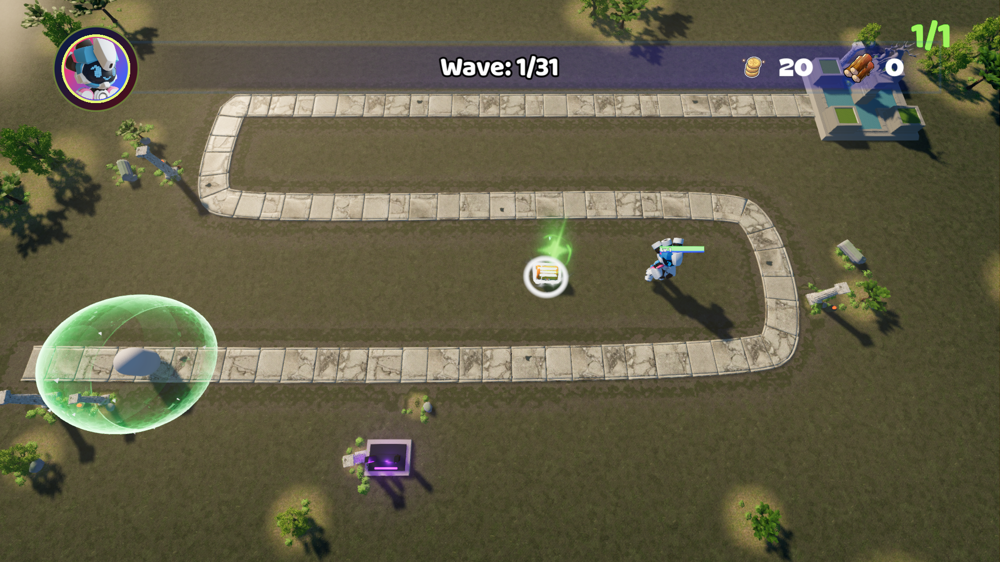
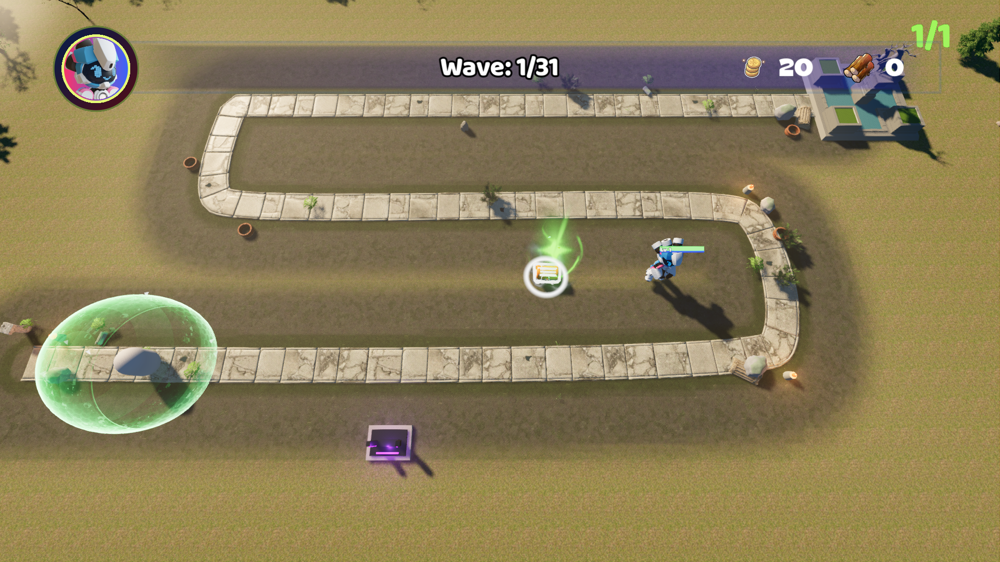
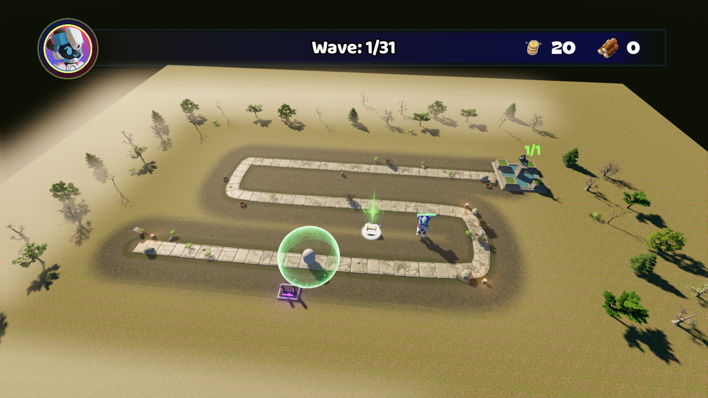
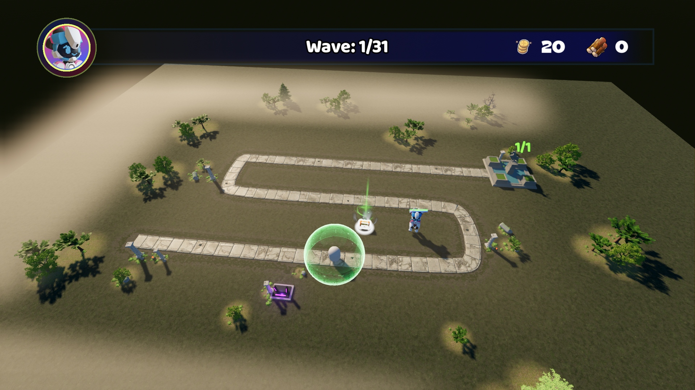
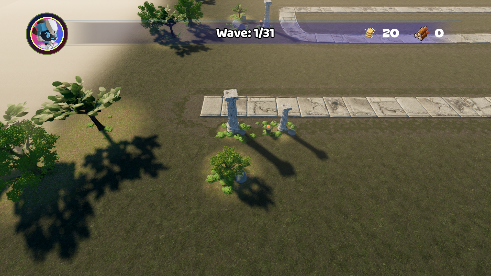
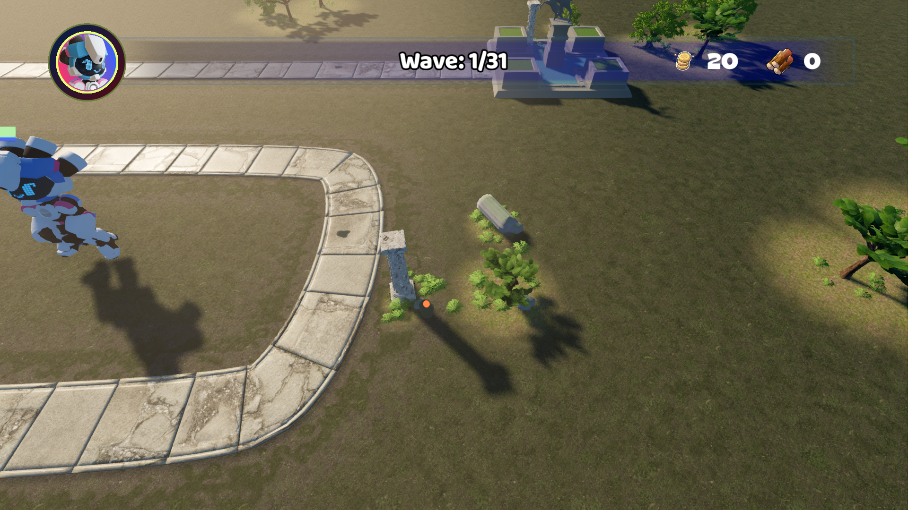
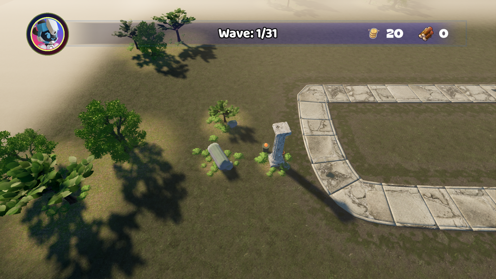
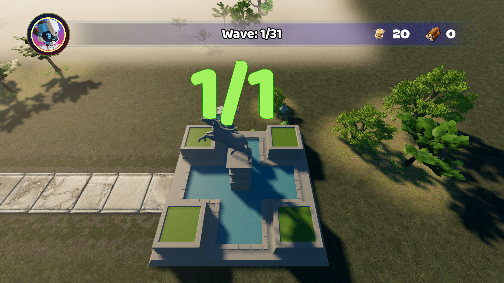
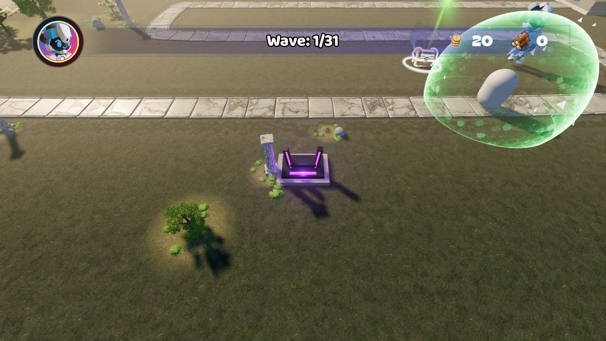

# Level1 场景摆放与设计验收

本轮以默认战斗镜头为主要验收视角，完成 38 棵乔木的成组重排、五处遗迹景观、20 个景观格置换和地表生态遮罩调整。可建造格数为 180。游戏入口为 `Main.tscn`。



| 改前 | 改后 |
|---|---|
|  |  |
|  |  |

| 景观组 | 实机局部 |
|---|---|
| 入口残柱与林缘 |  |
| 右回弯断柱、地被与火盆 |  |
| 左回弯遗迹 |  |
| 基地外侧景观 |  |
| 前景祭坛 |  |

所有截图均来自 Godot 4.7.2 Forward+。战斗视角等波次提示淡出后采集，全景与局部随后切换镜头采集，因此单位与战斗特效位置随时间变化。

## 布局与实现

五处景观分别集中在入口、右侧回弯、左侧回弯、基地外侧和前景祭坛。外围以不同宽度和朝向的树组衔接，地被沿树组及遗迹底部生长。共置换以下 20 格，坐标表示世界空间的 X、Z 中心。

| 区域 | 格子中心 |
|---|---|
| 入口 | −38,10／−34,10／−38,14 |
| 右回弯 | 22,2／26,2／26,−2 |
| 左回弯 | −34,−10／−38,−10／−38,−14 |
| 基地 | 30,−22／34,−22／34,−26 |
| 祭坛 | −14,14／−10,14／−10,10 |
| 外围 | 22,−42／26,−38／−18,18／−2,18／14,18 |

主景布置保存在 [scenery_layout.tscn](render_v10/scenery_layout.tscn)。位置、旋转和 `metadata/target_size` 可在场景中编辑。target_size 对立柱表示高度，对其他资产表示水平包围盒最大宽度。RuinsBuilder 在进入关卡时合并模型层级包围盒，调整模型中心和落地高度，施加 2.5 cm 沉降，然后应用共享材质并检查净空。

塔位保护范围为每个 4 米格子加四周 0.35 米余量。道路保护范围由怪物 Curve3D、1.2 米道路半宽和 0.4 米余量计算，再计入模型包围盒的水平半径。最终所有主景资产通过检查，拒绝列表为空。地被分别经过同样的净空检查，以 16 米分区 MultiMesh 批量绘制，关闭地被投影，使用 LOD1 蕨类。

主阔叶树采用标杆 LOD1。枝条和叶簇按共享材质合并为共享网格，其他树种继续提供轮廓变化。装饰模型碰撞层与掩码设为 0。

地表遮罩 R 通道存储道路距离，归一化范围为 25 米。G 通道离线存储树组与灌木覆盖，shader 一次读取两个通道，让林下腐叶跟随实际摆放，并用草甸和噪声打散路边色带。太阳能量为 1.40，环境补光为 0.48。

## 回归结果

| 项目 | 结果 |
|---|---|
| Headless 完整流程 | 三轮通过，FLOW_TEST_OK，孤立节点 0 |
| Forward+ 完整流程 | 三轮通过，FLOW_TEST_OK，孤立节点 0 |
| Headless 与 Forward+ 选取输入 | 67 项断言通过 |
| Headless 光标策略 | 19 项断言通过 |
| 原生光标策略 | 38 项断言通过 |
| 场景布局 | 180 格资格与地面射线检查通过，20 个景观格拒绝建造，主景越界数 0 |
| Forward+ 画质回归 | RTS_QUALITY_OK，覆盖 50／100／200 敌人、建造、切换与设置恢复 |
| 原生边缘滚屏 | 两次受系统鼠标位置变化中断，待完整验收 |

三轮流程回归包含实际建造与退出清理。180 格检查覆盖每格的建造资格和地面射线命中。

## 性能

设备为 RTX 3060、i7-11700K。下表使用 1920×1080、High、关闭垂直同步与帧率上限，每版采集首波场景的 600 帧。

| 指标 | 改前 | 改后 |
|---|---|---|
| P50 帧时间 | 5.570 ms | 7.389 ms |
| P95 帧时间 | 7.474 ms | 8.876 ms |
| P99 帧时间 | 7.868 ms | 9.164 ms |
| DrawCall | 1007 | 693 |
| 渲染图元 | 4,854,734 | 7,729,198 |
| 引擎报告显存 | 约 1606 MiB | 约 1409 MiB |

DrawCall 降低约 31%。更大的可见树组及其投影提高了图元数，P95 帧时间增加约 19%，仍满足计划中的 16.67 ms 门槛。首波场景采样包含运行中的单位与特效变化。[改前数据](render_v10/captures/redesign/before.json) · [改后数据](render_v10/captures/redesign/after.json)

现有持续渲染基准使用 30 塔与 100 个动画敌人，1080p，预热 10 秒、采样 30 秒，共 2309 帧。P95 为 **14.041 ms**，P99 为 **15.691 ms**，通过 P95 ≤ 16.667 ms、P99 ≤ 33.334 ms 的门槛。该基准冻结战斗逻辑并保留动画，用于评估渲染压力，完整战斗由流程回归覆盖。[持续基准数据](render_v10/captures/redesign/visual_benchmark.json)

画质回归中的短时压力采样使用 1080×768、High，每档采集 30 帧。

| 敌人数 | 平均帧时间 | P95 |
|---|---|---|
| 50 | 16.692 ms | 17.125 ms |
| 100 | 16.672 ms | 17.904 ms |
| 200 | 21.362 ms | 23.656 ms |

200 敌人条件下帧时间超过 16.67 ms。该项的重负载性能仍有优化空间。[压力采样](render_v10/captures/redesign/rts-performance.json)

## 复查入口

在项目根目录运行游戏。

```powershell
& 'H:\Godot\Godot_v4.7.2-stable_mono_win64\Godot_v4.7.2-stable_mono_win64_console.exe' --path 'H:\game-workflow\work\demo' 'res://Main.tscn'
```

编辑景观子场景后，使用以下命令根据场景位置重新烘焙生态遮罩，随后让 Godot 编辑器导入纹理。Python 环境需要 NumPy 和 Pillow。

```powershell
python render_v10/tools/build_layout.py --bake-only
```

完整运行该脚本会重新生成本轮的布局、20 格置换与遮罩。复核截图和 180 格检查使用 `tests/scene_layout_review.gd`，输出保存在 `.godot/scene_redesign`。

首次沙箱内渲染出现着色器缓存写入错误，沙箱外实机复核已完成。编辑器导入阶段仍出现根证书存储访问错误、HTerrain 的 headless shader 编译诊断及旧插件属性列表类型兼容诊断，导入进程正常退出。上述原生游戏回归日志通过了错误与泄漏检查。

两次原生边缘滚屏测试分别完成 3232 和 2031 项断言，失败数均为 0，随后检测到系统鼠标位置变化并退出。完整通过标志仍待取得，复查需要稳定的原生鼠标输入环境。日志位于 `.godot/check-forward-edge-scroll.log`。
